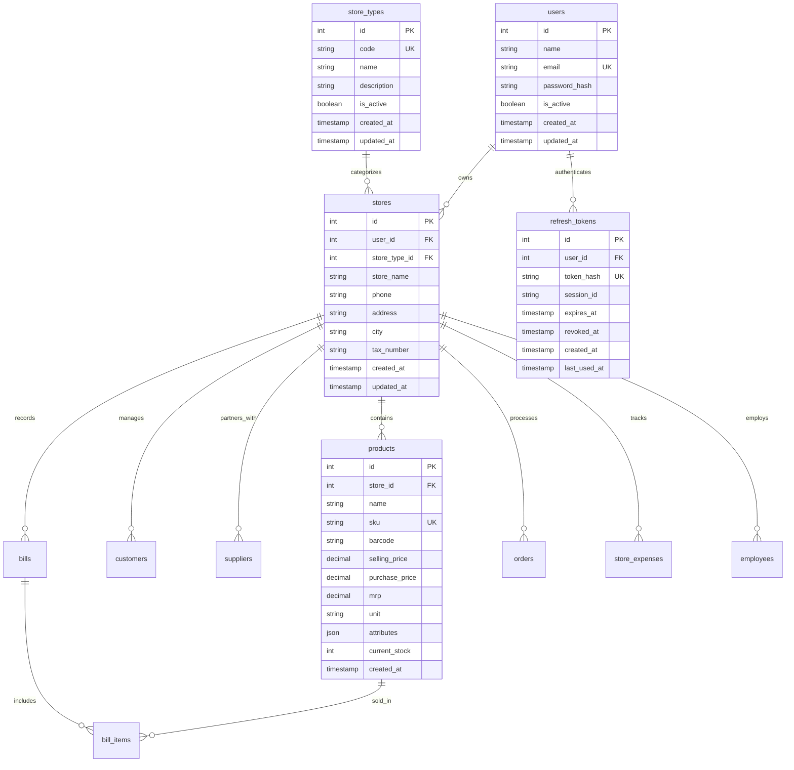

# Nexora Mart — Database Schema & Data Models

This document provides a comprehensive technical reference for the Nexora Mart relational database schema, entity relationships, constraints, indexes, and Alembic migrations.

---

## 1. Entity-Relationship Overview



---

## 2. Table Schemas & Specifications

### 2.1. `store_types`
Maintains the standardized catalog of supported retail and wholesale business categories.

| Column | Type | Constraints | Description |
|--------|------|-------------|-------------|
| `id` | `INTEGER` | `PRIMARY KEY AUTOINCREMENT` | Unique identifier |
| `code` | `VARCHAR(50)` | `UNIQUE, NOT NULL, INDEX` | Stable code (e.g. `grocery`, `clothing`, `medical`) |
| `name` | `VARCHAR(100)` | `NOT NULL` | Human-readable display name |
| `description` | `VARCHAR(255)` | `NULLABLE` | Description of the business vertical |
| `icon` | `VARCHAR(50)` | `NULLABLE` | UI icon representation |
| `is_active` | `BOOLEAN` | `DEFAULT TRUE, NOT NULL` | Soft enable/disable flag |
| `created_at` | `DATETIME` | `DEFAULT UTC_NOW` | Timestamp of creation |
| `updated_at` | `DATETIME` | `DEFAULT UTC_NOW, ON UPDATE` | Timestamp of last modification |

**Initial Seeded Records**:
1. `grocery` — Grocery Store
2. `clothing` — Clothing Store
3. `medical` — Medical / Pharmacy Store
4. `mobile_electronics` — Mobile & Electronics Store
5. `plastic` — Plastic Store
6. `handloom` — Handloom Store
7. `furniture` — Furniture Store
8. `agro` — Agro Store

---

### 2.2. `users`
Merchant user accounts and login credentials.

| Column | Type | Constraints | Description |
|--------|------|-------------|-------------|
| `id` | `INTEGER` | `PRIMARY KEY AUTOINCREMENT` | User ID |
| `name` | `VARCHAR(100)` | `NOT NULL` | Full merchant name |
| `email` | `VARCHAR(150)` | `UNIQUE, NOT NULL, INDEX` | Normalized email address |
| `password_hash` | `VARCHAR(255)` | `NOT NULL` | Bcrypt / Argon2 hashed password |
| `is_active` | `BOOLEAN` | `DEFAULT TRUE, NOT NULL` | Account active state |
| `created_at` | `DATETIME` | `DEFAULT UTC_NOW` | Registration timestamp |
| `updated_at` | `DATETIME` | `DEFAULT UTC_NOW, ON UPDATE` | Profile update timestamp |

---

### 2.3. `stores`
Stores owned and managed by merchants. Enforces multi-tenancy boundaries.

| Column | Type | Constraints | Description |
|--------|------|-------------|-------------|
| `id` | `INTEGER` | `PRIMARY KEY AUTOINCREMENT` | Store ID |
| `user_id` | `INTEGER` | `FOREIGN KEY(users.id), NOT NULL, INDEX` | Owner user ID |
| `store_type_id` | `INTEGER` | `FOREIGN KEY(store_types.id), NULLABLE, INDEX` | Associated store category |
| `name` / `store_name` | `VARCHAR(150)` | `NOT NULL` | Trading name of the store |
| `phone` | `VARCHAR(30)` | `NULLABLE` | Contact phone |
| `email` | `VARCHAR(150)` | `NULLABLE` | Store inquiry email |
| `address` | `TEXT` | `NULLABLE` | Physical shop address |
| `city` | `VARCHAR(100)` | `NULLABLE` | City location |
| `tax_number` | `VARCHAR(50)` | `NULLABLE` | Tax / GST / VAT identifier |
| `currency` | `VARCHAR(10)` | `DEFAULT 'USD'` | Primary transaction currency |
| `created_at` | `DATETIME` | `DEFAULT UTC_NOW` | Establishment timestamp |
| `updated_at` | `DATETIME` | `DEFAULT UTC_NOW, ON UPDATE` | Store update timestamp |

---

### 2.4. `refresh_tokens`
Tracks active and revoked refresh tokens for mobile session security.

| Column | Type | Constraints | Description |
|--------|------|-------------|-------------|
| `id` | `INTEGER` | `PRIMARY KEY AUTOINCREMENT` | Token ID |
| `user_id` | `INTEGER` | `FOREIGN KEY(users.id), NOT NULL, INDEX` | Associated user |
| `token_hash` | `VARCHAR(128)` | `UNIQUE, NOT NULL, INDEX` | SHA-256 hash of refresh token |
| `session_id` | `VARCHAR(64)` | `NOT NULL, INDEX` | Session family identifier (`sid`) |
| `expires_at` | `DATETIME` | `NOT NULL, INDEX` | Token expiry timestamp (15h limit) |
| `revoked_at` | `DATETIME` | `NULLABLE` | Null if active; set on logout/rotation |
| `created_at` | `DATETIME` | `DEFAULT UTC_NOW` | Token issuance timestamp |
| `last_used_at` | `DATETIME` | `DEFAULT UTC_NOW` | Timestamp of last token rotation |

---

### 2.5. `products`
Store-specific inventory catalog with dynamic JSON attribute support.

| Column | Type | Constraints | Description |
|--------|------|-------------|-------------|
| `id` | `INTEGER` | `PRIMARY KEY AUTOINCREMENT` | Product ID |
| `store_id` | `INTEGER` | `FOREIGN KEY(stores.id), NOT NULL, INDEX` | Multi-tenant isolation scope |
| `category_id` | `INTEGER` | `FOREIGN KEY(shop_categories.id), NULLABLE` | Optional sub-category |
| `name` | `VARCHAR(150)` | `NOT NULL, INDEX` | Product title |
| `sku` | `VARCHAR(50)` | `NOT NULL, INDEX` | Stock Keeping Unit |
| `barcode` | `VARCHAR(100)` | `NULLABLE, INDEX` | EAN / UPC barcode |
| `description` | `TEXT` | `NULLABLE` | Marketing / product details |
| `selling_price` | `DECIMAL(12, 2)`| `NOT NULL` | Outgoing retail price |
| `purchase_price`| `DECIMAL(12, 2)`| `DEFAULT 0.00` | Inward acquisition cost |
| `mrp` | `DECIMAL(12, 2)`| `NULLABLE` | Maximum Retail Price |
| `unit` | `VARCHAR(20)` | `DEFAULT 'pcs'` | Measurement unit |
| `min_stock_level`| `INTEGER` | `DEFAULT 5` | Low stock alert threshold |
| `current_stock` | `DECIMAL(12, 2)`| `DEFAULT 0.00` | Real-time available stock |
| `has_variants` | `BOOLEAN` | `DEFAULT FALSE` | Flag for child variants |
| `attributes` | `JSON` | `NULLABLE` | Dynamic store-type specifications |
| `is_active` | `BOOLEAN` | `DEFAULT TRUE, INDEX` | Active / deactivated status |
| `created_at` | `DATETIME` | `DEFAULT UTC_NOW` | Creation timestamp |
| `updated_at` | `DATETIME` | `DEFAULT UTC_NOW, ON UPDATE` | Last modification timestamp |

---

### 2.6. Additional Store-Scoped Tables
All business tables enforce tenant isolation via a mandatory `store_id` indexed foreign key:
- **`bills`**: Billing invoices (`id`, `store_id`, `bill_number`, `customer_id`, `subtotal`, `tax_amount`, `discount_amount`, `total_amount`, `payment_method`, `payment_status`).
- **`bill_items`**: Line items per bill (`id`, `bill_id`, `product_id`, `quantity`, `unit_price`, `tax_amount`, `total_price`).
- **`customers`**: Customer ledger (`id`, `store_id`, `name`, `phone`, `email`, `total_due`, `credit_limit`).
- **`suppliers`**: Vendor contacts (`id`, `store_id`, `name`, `company_name`, `phone`, `balance`).
- **`orders`**: Purchase and sales orders (`id`, `store_id`, `order_number`, `supplier_id`, `total_amount`, `status`).
- **`store_expenses`**: Operational expenses (`id`, `store_id`, `category`, `amount`, `payment_mode`, `expense_date`).
- **`employees`**: Staff records (`id`, `store_id`, `name`, `phone`, `role`, `salary`, `hire_date`).

---

## 3. Database Migrations (Alembic)

Database schema evolution is managed via Alembic.

### Key Migrations
- `001_initial_schema.py`: Initial schema creation for users, stores, products, bills, customers, suppliers.
- `2a3b4c5d6e7f_add_store_types_and_refresh_tokens.py`:
  - Creates `store_types` table.
  - Creates `refresh_tokens` table with compound indexes on `user_id` and `session_id`.
  - Adds `store_type_id` foreign key column to `stores`.
  - Seeds the 8 standard store types.

### Running Migrations
To upgrade the database to the latest schema:
```bash
alembic upgrade head
```

To roll back the most recent migration:
```bash
alembic downgrade -1
```

