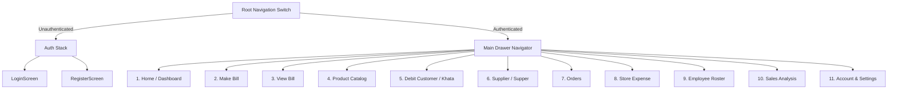

# Nexora Mart — Mobile Frontend Architecture

This document details the architecture, navigation design, state management, and component patterns of the Nexora Mart React Native mobile application.

---

## 1. Technology Stack

- **Framework**: React Native 0.75.4 (New Architecture ready)
- **Language**: TypeScript 5.6.2 (Strict type checking, `tsc --noEmit` verified)
- **Navigation**: React Navigation 6 (Native Stack + Drawer Navigation)
- **HTTP Client**: Axios 1.7.9 with custom concurrency-safe token refresh interceptors
- **Local Persistence**: AsyncStorage (with secure key architecture)
- **Icons & Vector Assets**: React Native Vector Icons & React Native SVG

---

## 2. Directory Structure

```
react-native-app/
├── src/
│   ├── api/                  # API client & endpoint constants
│   │   ├── apiClient.ts      # Axios instance, refresh queue & interceptors
│   │   └── endpoints.ts      # Centralized REST route constants
│   ├── components/           # Reusable UI component library
│   │   ├── branding/         # Logos, icons, and brand graphics
│   │   ├── common/           # Button, Input, Card, Header, Badge, Loader
│   │   └── navigation/       # Custom drawer and bottom tab bars
│   ├── constants/            # Colors, storage keys, and API URLs
│   ├── context/              # React Context state providers
│   │   ├── AuthContext.tsx   # User profile, store metadata, token lifecycle
│   │   └── ThemeContext.tsx  # Dynamic dark / light theme tokens
│   ├── hooks/                # Custom React hooks (useAuth, useTheme)
│   ├── models/               # TypeScript interfaces & domain types
│   │   └── types.ts          # StoreType, Product, User, Bill, Order, etc.
│   ├── navigation/           # Navigation routers & type definitions
│   │   ├── AppNavigator.tsx  # Root conditional switch (Auth vs App)
│   │   ├── DrawerNavigator.tsx # 11 Standardized business drawer screens
│   │   └── types.ts          # RootStackParamList & navigation prop types
│   ├── screens/              # Screen components grouped by feature
│   │   ├── auth/             # LoginScreen, RegisterScreen
│   │   ├── dashboard/        # DashboardScreen (Home)
│   │   ├── billing/          # MakeBillScreen, BillListScreen, BillDetailScreen
│   │   ├── products/         # ProductListScreen, AddProductScreen, EditProductScreen
│   │   ├── customers/        # CustomerKhataScreen, CustomerDetailScreen
│   │   ├── suppliers/        # SupplierListScreen ("Supper"), SupplierDetailScreen
│   │   ├── orders/           # OrderListScreen, CreateOrderScreen
│   │   ├── expenses/         # ExpenseListScreen, AddExpenseScreen
│   │   ├── employees/        # EmployeeListScreen, EmployeeDetailScreen
│   │   ├── analytics/        # SalesAnalysisScreen
│   │   └── account/          # AccountScreen, StoreSettingsScreen
│   ├── services/             # API integration service layer
│   │   ├── authService.ts    # Login, registration, token refresh, logout
│   │   ├── storeTypeService.ts # Store type retrieval
│   │   ├── productService.ts # CRUD & attribute mapping
│   │   └── billService.ts    # Invoicing and payment recording
│   ├── storeTypes/           # Dynamic store-type frontend registry
│   │   ├── types.ts          # StoreTypeConfig, StoreTypeField interfaces
│   │   ├── grocery.ts        # Grocery field definitions & validators
│   │   ├── clothing.ts       # Clothing field definitions & validators
│   │   ├── medical.ts        # Medical field definitions & validators
│   │   ├── mobileElectronics.ts # Mobile & Electronics definitions
│   │   ├── plastic.ts        # Plastic field definitions
│   │   ├── handloom.ts       # Handloom field definitions
│   │   ├── furniture.ts      # Furniture field definitions
│   │   ├── agro.ts           # Agro store definitions
│   │   └── index.ts          # Registry map & getStoreTypeConfig helper
│   └── utils/                # Currency formatters, dates, storage helpers
└── package.json
```

---

## 3. Navigation Hierarchy & 11 Standard Modules

The application navigation is organized so that every store merchant has immediate access to the 11 core retail and business management modules:



### Module Route Directory
1. **Home (`DashboardScreen`)**: KPI cards (today's revenue, active bills, low stock warnings, quick actions).
2. **Make Bill (`MakeBillScreen`)**: Point-of-sale barcode scanning, search-to-cart, taxes, discounts, and one-tap checkout.
3. **View Bill (`BillListScreen`)**: Chronological invoice ledger, filters by payment method, print/PDF receipt export.
4. **Product (`ProductListScreen`)**: Inventory catalog, search, stock levels, add/edit products with store-type dynamic attributes.
5. **Debit Customer (`CustomerKhataScreen`)**: Customer credit/debit balances, payment collection, reminders.
6. **Supplier ("Supper") (`SupplierListScreen`)**: Vendor accounts, purchase tracking, payment dues.
7. **Order (`OrderListScreen`)**: Inward purchase orders and outward customer orders.
8. **Store Expense (`ExpenseListScreen`)**: Rent, electricity, maintenance, logistics, and petty cash tracking.
9. **Employee (`EmployeeListScreen`)**: Staff directory, roles, wage disbursements, and attendance.
10. **Sales Analysis (`SalesAnalysisScreen`)**: Graphical revenue trends, top-selling categories, profit margins.
11. **Account (`AccountScreen`)**: Store profile, tax registration, address, currency settings, and logout.

---

## 4. Dynamic Store-Type Attribute System

To avoid cumbersome conditional blocks across forms, the frontend uses the Strategy Pattern via `src/storeTypes/`.

### StoreTypeConfig Interface
```typescript
export interface StoreTypeField {
  fieldName: string;
  fieldLabel: string;
  fieldType: 'text' | 'number' | 'select' | 'date' | 'boolean';
  isRequired: boolean;
  options?: string[];
  defaultValue?: string;
  placeholder?: string;
  helpText?: string;
}

export interface StoreTypeConfig {
  code: string;
  name: string;
  icon: string;
  description: string;
  defaultUnits: string[];
  fields: StoreTypeField[];
  validate: (values: Record<string, any>) => { isValid: boolean; error?: string };
}
```

### Dynamic Field Rendering (`AddProductScreen.tsx` & `EditProductScreen.tsx`)
1. Detects store type from `AuthContext`:
   ```typescript
   const { store, user } = useAuth();
   const storeTypeCode = store?.store_type?.code || (user as any)?.storeType || 'grocery';
   const storeTypeConfig = getStoreTypeConfig(storeTypeCode);
   ```
2. Automatically pre-populates specialized measurement units (`storeTypeConfig.defaultUnits`).
3. Iterates over `storeTypeConfig.fields`:
   - `boolean` fields render a native toggle switch with clear label and helper notes.
   - `select` fields render horizontal selectable pill chips.
   - `number` fields trigger numeric keypads.
4. Validates client-side before calling the API:
   ```typescript
   const validation = storeTypeConfig.validate(attributes);
   if (!validation.isValid) {
     Alert.alert('Store Type Validation', validation.error);
     return;
   }
   ```

---

## 5. Build, Bundle & Quality Verification

### TypeScript Type-Checking
The application enforces strict typing:
```bash
cd react-native-app
npm run lint
```
*Output: `tsc --noEmit` exits with 0 errors.*

### Android JavaScript Bundling
To verify compilation and asset bundling for Android release:
```bash
cd react-native-app
npm run bundle:android
```
*Output: Bundles JavaScript code into `android/app/src/main/assets/index.android.bundle` and copies assets into `res`.*

