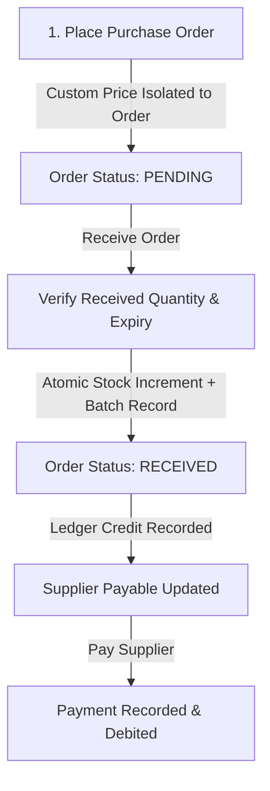

# Tulsi Mart – Purchase Order & Receiving Flow

## 1. Purchase Order Lifecycle

---

## 2. Crucial Business Rules

### Rule 1: Custom Purchase Price Isolation
- The purchase price entered in a purchase order row is isolated to that specific order document.
- It **never mutates or overwrites** the master catalog purchase price in the product registry.

### Rule 2: Stock Increment Timing
- Placing a purchase order does **NOT** increase active inventory.
- Stock is incremented **only upon confirmed receipt** via `POST /api/v1/orders/purchases/{id}/receive`.

### Rule 3: Prevention of Duplicate Receipts
- Orders that are already `RECEIVED` cannot be received again.
- The backend verifies order status under database row-level locking to prevent concurrent double-receipts.

### Rule 4: Supplier Ledger Accounting
- Upon receipt, the order value is automatically credited to the supplier's running balance in `supplier_ledger`.
- When payments are recorded via `POST /api/v1/orders/purchases/{id}/pay` or the Supplier Ledger modal, a matching debit entry is written.
