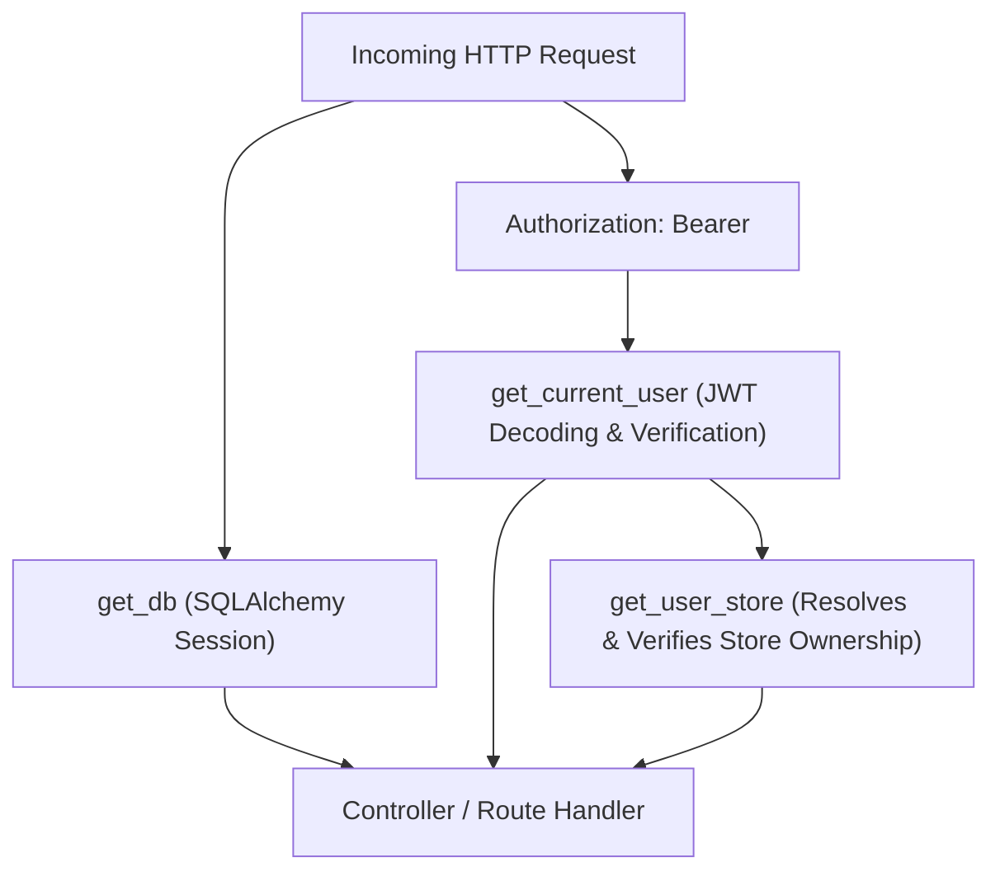

# Nexora Mart — Routing & Middleware Architecture

This document describes the routing topology, middleware pipelines, dependency injection graphs, and navigation configurations across both the FastAPI backend and React Native frontend.

---

## 1. Backend Routing Architecture

FastAPI organizes routes hierarchically using `APIRouter`. To ensure backwards compatibility with legacy client builds while adhering to API versioning standards, all routes are mounted under two prefixes in `backend/app/main.py`:
- `/api` (Direct endpoint prefix)
- `/api/v1` (Versioned endpoint prefix)

### 1.1. Backend Router Directory

```
FastAPI Root Application
  ├── CORS Middleware (Cross-Origin Resource Sharing)
  ├── SlowAPI Limiter Middleware (Rate limiting)
  ├── Request Logging & Timer Middleware
  │
  ├── Mounting: /api & /api/v1
  │     ├── /auth           --> auth_routes.py
  │     ├── /store-types    --> store_type_routes.py
  │     ├── /stores         --> store_routes.py
  │     ├── /products       --> product_routes.py
  │     ├── /bills          --> bill_routes.py
  │     ├── /orders         --> order_routes.py
  │     ├── /account        --> account_routes.py
  │     ├── /analytics      --> account_routes.py / report_routes.py
  │     ├── /expenses       --> expense_routes.py
  │     ├── /employees      --> employee_routes.py
  │     ├── /customers      --> customer_routes.py
  │     └── /suppliers      --> supplier_routes.py
  │
  └── OpenAPI / Swagger UI (/docs, /redoc)
```

---

## 2. Dependency Injection Graph

FastAPI's `Depends` system governs request security, database session scopes, and multi-tenant store resolution:



### Dependency Implementation Flow
1. **`get_db()`**: Yields a scoped SQLAlchemy database session and ensures cleanup (`db.close()`) after the response terminates.
2. **`get_current_user(token, db)`**:
   - Extracts and verifies JWT signature using `SECRET_KEY` and `HS256`.
   - Validates `exp`, `iss`, and `aud`.
   - Fetches the user record from `users`. If `is_active` is false, raises `401 Unauthorized`.
3. **`get_user_store(db, user_id)`**:
   - Queries `stores` where `user_id == user.id`.
   - If no store is found, raises `404 Not Found`.
   - In endpoints where a path parameter `{store_id}` is passed, it validates that `store.user_id == user.id`. A mismatch immediately aborts with `403 Forbidden`.

---

## 3. Middleware Order of Execution

Requests traverse the middleware pipeline in the following sequence:

1. **CORS Middleware**: Intercepts OPTIONS pre-flight requests and handles allowed origins, headers, and credentials.
2. **Rate Limiting Middleware**: SlowAPI tracks client IP addresses and enforces rate throttles on sensitive endpoints (e.g. 5 requests/minute on `/auth/login`).
3. **Correlation & Request Timing Middleware**: Assigns a unique `X-Request-ID` and measures processing latency.
4. **Exception Handling Middleware**: Normalizes unhandled Python exceptions into RFC 7807 compliant JSON errors with status `500 Internal Server Error`.

---

## 4. Frontend React Navigation Structure

The mobile app employs a nested navigation hierarchy powered by `@react-navigation/native-stack` and `@react-navigation/drawer`:

```typescript
// Type definitions in src/navigation/types.ts
export type RootStackParamList = {
  Auth: undefined;
  Main: undefined;
  ProductDetail: { productId: number };
  AddProduct: { categoryId?: number };
  EditProduct: { productId: number };
  BillDetail: { billId: number };
  MakeBill: undefined;
  CustomerDetail: { customerId: number };
  SupplierDetail: { supplierId: number };
};
```

### Route Switching Matrix

```
                 +-------------------+
                 |  AppNavigator.tsx |
                 +-------------------+
                           |
            +--------------+--------------+
            |                             |
      (Unauthenticated)             (Authenticated)
            v                             v
+-----------------------+     +-----------------------+
|      AuthStack        |     |     DrawerNavigator   |
+-----------------------+     +-----------------------+
| - LoginScreen         |     | 1. Home               |
| - RegisterScreen      |     | 2. Make Bill          |
+-----------------------+     | 3. View Bill          |
                              | 4. Product Catalog    |
                              | 5. Debit Customer     |
                              | 6. Supplier (Supper)  |
                              | 7. Orders             |
                              | 8. Store Expense      |
                              | 9. Employee Roster    |
                              | 10. Sales Analysis    |
                              | 11. Account / Config  |
                              +-----------------------+
```

### Deep Linking Configuration
Nexora Mart supports URI schemes for direct routing:
- Scheme: `nexoramart://`
- Configured prefixes: `nexoramart://`, `https://app.nexoramart.com`
- Mappings:
  - `nexoramart://bill/:billId` -> `BillDetailScreen`
  - `nexoramart://product/:productId` -> `ProductDetailScreen`
  - `nexoramart://make-bill` -> `MakeBillScreen`

