# NMART - Complete Database Documentation & Architecture Specification

## 1. Database Architecture

The NMART database architecture is engineered as a highly scalable, multi-tenant, multi-store relational database system powered by MySQL.

### Core Architectural Principles

1. **Strict Multi-Store Data Isolation**:
   - A single registered user (`users`) can own and operate multiple independent retail stores (`stores`).
   - Every store-scoped business entity (products, inventory, invoices, orders, customers, debit accounts, suppliers, expenses, employees, sequences, activity logs) strictly mandates a `store_id` foreign key.
   - Cross-store queries and writes are strictly partitioned and validated at both the database level (foreign keys and composite indexes) and the application layer.

2. **Support for Diverse Retail Business Verticals**:
   - Built to support 8 major retail categories:
     1. Supermarket & Grocery
     2. Electronics & Mobile
     3. Clothing & Fashion
     4. Pharmacy & Medical
     5. Footwear
     6. Hardware & Electrical
     7. Book Store & Stationery
     8. Cosmetics & Beauty
   - Generic standard product catalog complemented by dynamic attributes (`product_attributes` and `product_attribute_values`) allows arbitrary industry-specific metadata (e.g., expiry date and batch for pharmacy, IMEI and warranty for electronics, size and color for clothing/footwear, author and ISBN for bookstore) without schema duplication.

3. **Complete Financial & Inventory Lifecycle**:
   - Full point-of-sale invoicing (`invoices`, `invoice_items`) with transaction logs (`payments`).
   - Customer debit accounts with dedicated ledger tracking (`debit_customers`).
   - Procurement workflow (`purchases`, `purchase_items`).
   - Stock movements, batch tracking, and audit-level adjustments (`stock_adjustments`, `product_stock`).
   - Customer sales returns and refunds (`returns`, `return_items`, `refunds`).
   - Human resources and staff management (`employees`).
   - Document numbering sequences (`document_sequences`) ensuring sequential document IDs (e.g., `INV-0001`, `ORD-0001`).
   - System audit trail and security logs (`activity_logs`).

---

## 2. Complete Table List

| # | Table Name | Category / Module | Purpose |
|---|------------|-------------------|---------|
| 1 | `users` | Authentication | Merchant accounts, user credentials, contact details, global role |
| 2 | `password_reset_otps` | Authentication | One-time passwords for password recovery and account verification |
| 3 | `shop_categories` | Store Management | System-defined 8 retail store business verticals |
| 4 | `stores` | Store Management | Merchant physical/digital store entities |
| 5 | `store_owner_details` | Store Management | KYC, PAN, Aadhaar, legal identity of store owner |
| 6 | `store_addresses` | Store Management | Physical location, city, state, postal address of stores |
| 7 | `store_business_details` | Store Management | Legal entity name, GSTIN, trade licenses, tax configuration |
| 8 | `store_configurations` | Store Management | Store-level operational settings (tax rate, barcode, low stock alert) |
| 9 | `product_categories` | Product Category | Store-specific product categories (Dairy, Beverages, Men's wear) |
| 10 | `product_attributes` | Product Management | Dynamic attribute definitions per shop category or store |
| 11 | `products` | Product Management | Core product master record (SKU, barcode, name, pricing, unit) |
| 12 | `product_attribute_values` | Product Management | Dynamic attribute values for specific products |
| 13 | `product_images` | Product Management | Product gallery and visual assets |
| 14 | `product_stock` | Inventory Management | Real-time stock levels, batches, expiry dates, shelf locations |
| 15 | `customers` | Customer Management | Customer contact directory, master balance, credit limits |
| 16 | `debit_customers` | Debit Management | Dedicated debit account ledger, payment terms, due dates |
| 17 | `suppliers` | Supplier Management | Vendor directory, company details, outstanding balances |
| 18 | `purchases` | Purchase Management | Inward purchase bills from suppliers |
| 19 | `purchase_items` | Purchase Management | Line items for purchases with cost price, batch, expiry |
| 20 | `orders` | Order Management | Customer sales orders, bookings, and quotations |
| 21 | `order_items` | Order Management | Line items for customer orders |
| 22 | `invoices` | Billing & Invoicing | Point of sale finalized sales bills, tax, discounts |
| 23 | `invoice_items` | Billing & Invoicing | Line items sold on an invoice with selling price and quantity |
| 24 | `payments` | Payment Management | Receipts and transaction audit for invoices, purchases, debits |
| 25 | `expenses` | Expense Management | Operational store expenditures (Rent, Utilities, Salaries) |
| 26 | `employees` | Employee Management | Store staff, cashiers, managers, payroll and access |
| 27 | `returns` | Return Management | Product return claims from customers |
| 28 | `return_items` | Return Management | Line items returned with reasons and restocking conditions |
| 29 | `refunds` | Refund Management | Financial disbursements for processed returns |
| 30 | `stock_adjustments` | Inventory Management | Stock write-offs, damages, stock-taking count adjustments |
| 31 | `document_sequences` | Document Sequences | Auto-incrementing sequential document counters per store |
| 32 | `activity_logs` | Activity & Audit Logs | Security audit trail, actions, changes, timestamps |
| 33 | `daily_sales_analytics` | Sales Analysis | Aggregated daily sales, order count, and revenue metrics |

---

## 3. Detailed Table Specifications

### 3.1 Authentication Tables

#### Table: `users`
- **Description**: Stores user login credentials, personal identification, and global role.
- **Columns**:

| Column Name | Data Type | PK | FK | Unique | NOT NULL | Default Value | Auto Increment | Indexes |
|-------------|-----------|----|----|--------|----------|---------------|----------------|---------|
| `id` | INT | Yes | No | Yes | Yes | None | Yes | `PRIMARY` |
| `first_name` | VARCHAR(100) | No | No | No | Yes | None | No | - |
| `surname` | VARCHAR(100) | No | No | No | Yes | None | No | - |
| `email` | VARCHAR(255) | No | No | Yes | Yes | None | No | `idx_users_email` (Unique) |
| `phone` | VARCHAR(50) | No | No | No | Yes | None | No | `idx_users_phone` |
| `store_type` | VARCHAR(100) | No | No | No | No | NULL | No | - |
| `hashed_password` | VARCHAR(255) | No | No | No | Yes | None | No | - |
| `role` | VARCHAR(50) | No | No | No | Yes | 'owner' | No | `idx_users_role` |
| `is_active` | BOOLEAN | No | No | No | Yes | TRUE | No | `idx_users_is_active` |
| `created_at` | DATETIME | No | No | No | Yes | CURRENT_TIMESTAMP | No | `idx_users_created_at` |
| `updated_at` | DATETIME | No | No | No | Yes | CURRENT_TIMESTAMP | No | - |

---

#### Table: `password_reset_otps`
- **Description**: Temporary security verification codes for password reset and authentication.
- **Columns**:

| Column Name | Data Type | PK | FK | Unique | NOT NULL | Default Value | Auto Increment | Indexes |
|-------------|-----------|----|----|--------|----------|---------------|----------------|---------|
| `id` | INT | Yes | No | Yes | Yes | None | Yes | `PRIMARY` |
| `user_id` | INT | No | `users(id)` | No | No | NULL | No | `idx_otps_user_id` |
| `email` | VARCHAR(255) | No | No | No | Yes | None | No | `idx_otps_email` |
| `otp_code` | VARCHAR(10) | No | No | No | Yes | None | No | `idx_otps_code` |
| `otp_type` | VARCHAR(50) | No | No | No | Yes | 'RESET_PASSWORD' | No | - |
| `is_used` | BOOLEAN | No | No | No | Yes | FALSE | No | `idx_otps_is_used` |
| `expires_at` | DATETIME | No | No | No | Yes | None | No | `idx_otps_expires_at` |
| `created_at` | DATETIME | No | No | No | Yes | CURRENT_TIMESTAMP | No | - |

---

### 3.2 Store Management Tables

#### Table: `shop_categories`
- **Description**: System catalogue of the 8 predefined retail industry verticals.
- **Columns**:

| Column Name | Data Type | PK | FK | Unique | NOT NULL | Default Value | Auto Increment | Indexes |
|-------------|-----------|----|----|--------|----------|---------------|----------------|---------|
| `id` | INT | Yes | No | Yes | Yes | None | Yes | `PRIMARY` |
| `name` | VARCHAR(100) | No | No | Yes | Yes | None | No | `idx_shop_cat_name` (Unique) |
| `code` | VARCHAR(50) | No | No | Yes | Yes | None | No | `idx_shop_cat_code` (Unique) |
| `description` | TEXT | No | No | No | No | NULL | No | - |
| `icon` | VARCHAR(100) | No | No | No | No | NULL | No | - |
| `is_system` | BOOLEAN | No | No | No | Yes | TRUE | No | - |
| `is_active` | BOOLEAN | No | No | No | Yes | TRUE | No | `idx_shop_cat_active` |
| `created_at` | DATETIME | No | No | No | Yes | CURRENT_TIMESTAMP | No | - |

---

#### Table: `stores`
- **Description**: Stores merchant retail shops, linked to owner users.
- **Columns**:

| Column Name | Data Type | PK | FK | Unique | NOT NULL | Default Value | Auto Increment | Indexes |
|-------------|-----------|----|----|--------|----------|---------------|----------------|---------|
| `id` | INT | Yes | No | Yes | Yes | None | Yes | `PRIMARY` |
| `user_id` | INT | No | `users(id)` | No | Yes | None | No | `idx_stores_user_id` |
| `shop_category_id` | INT | No | `shop_categories(id)` | No | Yes | None | No | `idx_stores_category_id` |
| `name` | VARCHAR(150) | No | No | No | Yes | None | No | `idx_stores_name` |
| `code` | VARCHAR(50) | No | No | No | No | NULL | No | `idx_stores_code` |
| `currency` | VARCHAR(10) | No | No | No | Yes | 'INR' | No | - |
| `currency_symbol` | VARCHAR(10) | No | No | No | Yes | '₹' | No | - |
| `logo_url` | VARCHAR(500) | No | No | No | No | NULL | No | - |
| `is_active` | BOOLEAN | No | No | No | Yes | TRUE | No | `idx_stores_is_active` |
| `created_at` | DATETIME | No | No | No | Yes | CURRENT_TIMESTAMP | No | - |
| `updated_at` | DATETIME | No | No | No | Yes | CURRENT_TIMESTAMP | No | - |

---

#### Table: `store_owner_details`
- **Description**: KYC and legal ownership identity details for a store.
- **Columns**:

| Column Name | Data Type | PK | FK | Unique | NOT NULL | Default Value | Auto Increment | Indexes |
|-------------|-----------|----|----|--------|----------|---------------|----------------|---------|
| `id` | INT | Yes | No | Yes | Yes | None | Yes | `PRIMARY` |
| `store_id` | INT | No | `stores(id)` | Yes | Yes | None | No | `idx_owner_store_id` (Unique) |
| `owner_name` | VARCHAR(150) | No | No | No | Yes | None | No | - |
| `contact_phone` | VARCHAR(50) | No | No | No | No | NULL | No | - |
| `contact_email` | VARCHAR(255) | No | No | No | No | NULL | No | - |
| `pan_number` | VARCHAR(50) | No | No | No | No | NULL | No | `idx_owner_pan` |
| `aadhaar_number` | VARCHAR(50) | No | No | No | No | NULL | No | - |
| `created_at` | DATETIME | No | No | No | Yes | CURRENT_TIMESTAMP | No | - |
| `updated_at` | DATETIME | No | No | No | Yes | CURRENT_TIMESTAMP | No | - |

---

#### Table: `store_addresses`
- **Description**: Physical location, premises address, and city for stores.
- **Columns**:

| Column Name | Data Type | PK | FK | Unique | NOT NULL | Default Value | Auto Increment | Indexes |
|-------------|-----------|----|----|--------|----------|---------------|----------------|---------|
| `id` | INT | Yes | No | Yes | Yes | None | Yes | `PRIMARY` |
| `store_id` | INT | No | `stores(id)` | No | Yes | None | No | `idx_address_store_id` |
| `address_line1` | VARCHAR(255) | No | No | No | Yes | None | No | - |
| `address_line2` | VARCHAR(255) | No | No | No | No | NULL | No | - |
| `city` | VARCHAR(100) | No | No | No | Yes | None | No | `idx_address_city` |
| `state` | VARCHAR(100) | No | No | No | No | NULL | No | - |
| `country` | VARCHAR(100) | No | No | No | Yes | 'India' | No | - |
| `postal_code` | VARCHAR(20) | No | No | No | No | NULL | No | `idx_address_postal` |
| `is_primary` | BOOLEAN | No | No | No | Yes | TRUE | No | - |
| `created_at` | DATETIME | No | No | No | Yes | CURRENT_TIMESTAMP | No | - |
| `updated_at` | DATETIME | No | No | No | Yes | CURRENT_TIMESTAMP | No | - |

---

#### Table: `store_business_details`
- **Description**: GST, taxation, trade licenses, and business entity status.
- **Columns**:

| Column Name | Data Type | PK | FK | Unique | NOT NULL | Default Value | Auto Increment | Indexes |
|-------------|-----------|----|----|--------|----------|---------------|----------------|---------|
| `id` | INT | Yes | No | Yes | Yes | None | Yes | `PRIMARY` |
| `store_id` | INT | No | `stores(id)` | Yes | Yes | None | No | `idx_biz_store_id` (Unique) |
| `legal_name` | VARCHAR(200) | No | No | No | No | NULL | No | - |
| `business_type` | VARCHAR(100) | No | No | No | No | 'Retail' | No | - |
| `gstin` | VARCHAR(50) | No | No | No | No | NULL | No | `idx_biz_gstin` |
| `trade_license_no` | VARCHAR(100) | No | No | No | No | NULL | No | - |
| `tax_type` | VARCHAR(50) | No | No | No | Yes | 'GST' | No | - |
| `created_at` | DATETIME | No | No | No | Yes | CURRENT_TIMESTAMP | No | - |
| `updated_at` | DATETIME | No | No | No | Yes | CURRENT_TIMESTAMP | No | - |

---

#### Table: `store_configurations`
- **Description**: Operational configurations, invoice formatting, POS settings per store.
- **Columns**:

| Column Name | Data Type | PK | FK | Unique | NOT NULL | Default Value | Auto Increment | Indexes |
|-------------|-----------|----|----|--------|----------|---------------|----------------|---------|
| `id` | INT | Yes | No | Yes | Yes | None | Yes | `PRIMARY` |
| `store_id` | INT | No | `stores(id)` | Yes | Yes | None | No | `idx_config_store_id` (Unique) |
| `enable_barcode_scanner`| BOOLEAN | No | No | No | Yes | TRUE | No | - |
| `low_stock_threshold` | INT | No | No | No | Yes | 5 | No | - |
| `tax_rate` | FLOAT | No | No | No | Yes | 0.0 | No | - |
| `invoice_prefix` | VARCHAR(20) | No | No | No | Yes | 'INV' | No | - |
| `invoice_footer_note` | TEXT | No | No | No | No | 'Thank you for shopping with us!' | No | - |
| `allow_negative_stock` | BOOLEAN | No | No | No | Yes | FALSE | No | - |
| `dark_mode_default` | BOOLEAN | No | No | No | Yes | FALSE | No | - |
| `created_at` | DATETIME | No | No | No | Yes | CURRENT_TIMESTAMP | No | - |
| `updated_at` | DATETIME | No | No | No | Yes | CURRENT_TIMESTAMP | No | - |

---

### 3.3 Product Management & Category Tables

#### Table: `product_categories`
- **Description**: Departmental categorization within a store (e.g. Dairy, Grocery, Beverages).
- **Columns**:

| Column Name | Data Type | PK | FK | Unique | NOT NULL | Default Value | Auto Increment | Indexes |
|-------------|-----------|----|----|--------|----------|---------------|----------------|---------|
| `id` | INT | Yes | No | Yes | Yes | None | Yes | `PRIMARY` |
| `store_id` | INT | No | `stores(id)` | No | No | NULL | No | `idx_prod_cat_store_id` |
| `shop_category_id` | INT | No | `shop_categories(id)` | No | No | NULL | No | `idx_prod_cat_shop_cat` |
| `name` | VARCHAR(100) | No | No | No | Yes | None | No | `idx_prod_cat_name` |
| `code` | VARCHAR(50) | No | No | No | No | NULL | No | `idx_prod_cat_code` |
| `description` | TEXT | No | No | No | No | NULL | No | - |
| `icon` | VARCHAR(100) | No | No | No | No | NULL | No | - |
| `is_active` | BOOLEAN | No | No | No | Yes | TRUE | No | `idx_prod_cat_active` |
| `created_at` | DATETIME | No | No | No | Yes | CURRENT_TIMESTAMP | No | - |

---

#### Table: `product_attributes`
- **Description**: Schema definitions for dynamic fields supported across categories (Size, Expiry, IMEI, etc.).
- **Columns**:

| Column Name | Data Type | PK | FK | Unique | NOT NULL | Default Value | Auto Increment | Indexes |
|-------------|-----------|----|----|--------|----------|---------------|----------------|---------|
| `id` | INT | Yes | No | Yes | Yes | None | Yes | `PRIMARY` |
| `shop_category_id` | INT | No | `shop_categories(id)` | No | No | NULL | No | `idx_attr_shop_cat_id` |
| `store_id` | INT | No | `stores(id)` | No | No | NULL | No | `idx_attr_store_id` |
| `field_name` | VARCHAR(100) | No | No | No | Yes | None | No | `idx_attr_field_name` |
| `field_label` | VARCHAR(100) | No | No | No | Yes | None | No | - |
| `field_type` | VARCHAR(50) | No | No | No | Yes | 'text' | No | - |
| `is_required` | BOOLEAN | No | No | No | Yes | FALSE | No | - |
| `options` | JSON | No | No | No | No | NULL | No | - |
| `default_value` | VARCHAR(255) | No | No | No | No | NULL | No | - |
| `placeholder` | VARCHAR(255) | No | No | No | No | NULL | No | - |
| `help_text` | VARCHAR(255) | No | No | No | No | NULL | No | - |
| `display_order` | INT | No | No | No | Yes | 0 | No | - |
| `is_variant_field` | BOOLEAN | No | No | No | Yes | FALSE | No | - |
| `created_at` | DATETIME | No | No | No | Yes | CURRENT_TIMESTAMP | No | - |

---

#### Table: `products`
- **Description**: Central product inventory catalog master record.
- **Columns**:

| Column Name | Data Type | PK | FK | Unique | NOT NULL | Default Value | Auto Increment | Indexes |
|-------------|-----------|----|----|--------|----------|---------------|----------------|---------|
| `id` | INT | Yes | No | Yes | Yes | None | Yes | `PRIMARY` |
| `store_id` | INT | No | `stores(id)` | No | Yes | None | No | `idx_prod_store_id` |
| `product_category_id`| INT | No | `product_categories(id)` | No | No | NULL | No | `idx_prod_cat_id` |
| `shop_category_id` | INT | No | `shop_categories(id)` | No | No | NULL | No | `idx_prod_shop_cat` |
| `name` | VARCHAR(200) | No | No | No | Yes | None | No | `idx_prod_name` |
| `sku` | VARCHAR(100) | No | No | No | No | NULL | No | `idx_prod_sku` |
| `barcode` | VARCHAR(100) | No | No | No | No | NULL | No | `idx_prod_barcode` |
| `description` | TEXT | No | No | No | No | NULL | No | - |
| `image_url` | VARCHAR(500) | No | No | No | No | NULL | No | - |
| `purchase_price` | FLOAT | No | No | No | Yes | 0.0 | No | - |
| `selling_price` | FLOAT | No | No | No | Yes | 0.0 | No | `idx_prod_price` |
| `mrp` | FLOAT | No | No | No | No | NULL | No | - |
| `unit` | VARCHAR(50) | No | No | No | Yes | 'piece' | No | - |
| `min_stock_level` | INT | No | No | No | Yes | 5 | No | - |
| `is_active` | BOOLEAN | No | No | No | Yes | TRUE | No | `idx_prod_is_active` |
| `has_variants` | BOOLEAN | No | No | No | Yes | FALSE | No | - |
| `created_at` | DATETIME | No | No | No | Yes | CURRENT_TIMESTAMP | No | `idx_prod_created_at` |
| `updated_at` | DATETIME | No | No | No | Yes | CURRENT_TIMESTAMP | No | - |

---

#### Table: `product_attribute_values`
- **Description**: Dynamic vertical-specific attribute values attached to products.
- **Columns**:

| Column Name | Data Type | PK | FK | Unique | NOT NULL | Default Value | Auto Increment | Indexes |
|-------------|-----------|----|----|--------|----------|---------------|----------------|---------|
| `id` | INT | Yes | No | Yes | Yes | None | Yes | `PRIMARY` |
| `store_id` | INT | No | `stores(id)` | No | Yes | None | No | `idx_val_store_id` |
| `product_id` | INT | No | `products(id)` | No | Yes | None | No | `idx_val_prod_id` |
| `attribute_id` | INT | No | `product_attributes(id)` | No | Yes | None | No | `idx_val_attr_id` |
| `attribute_value` | TEXT | No | No | No | No | NULL | No | - |
| `created_at` | DATETIME | No | No | No | Yes | CURRENT_TIMESTAMP | No | - |

---

#### Table: `product_images`
- **Description**: Product photo gallery, catalog media assets.
- **Columns**:

| Column Name | Data Type | PK | FK | Unique | NOT NULL | Default Value | Auto Increment | Indexes |
|-------------|-----------|----|----|--------|----------|---------------|----------------|---------|
| `id` | INT | Yes | No | Yes | Yes | None | Yes | `PRIMARY` |
| `store_id` | INT | No | `stores(id)` | No | Yes | None | No | `idx_img_store_id` |
| `product_id` | INT | No | `products(id)` | No | Yes | None | No | `idx_img_prod_id` |
| `image_url` | VARCHAR(500) | No | No | No | Yes | None | No | - |
| `is_primary` | BOOLEAN | No | No | No | Yes | FALSE | No | - |
| `display_order` | INT | No | No | No | Yes | 0 | No | - |
| `created_at` | DATETIME | No | No | No | Yes | CURRENT_TIMESTAMP | No | - |

---

### 3.4 Inventory Management Tables

#### Table: `product_stock`
- **Description**: Real-time on-hand stock quantities, batch details, and expiry dates.
- **Columns**:

| Column Name | Data Type | PK | FK | Unique | NOT NULL | Default Value | Auto Increment | Indexes |
|-------------|-----------|----|----|--------|----------|---------------|----------------|---------|
| `id` | INT | Yes | No | Yes | Yes | None | Yes | `PRIMARY` |
| `store_id` | INT | No | `stores(id)` | No | Yes | None | No | `idx_stock_store_id` |
| `product_id` | INT | No | `products(id)` | No | Yes | None | No | `idx_stock_prod_id` |
| `variant_id` | INT | No | No | No | No | NULL | No | `idx_stock_var_id` |
| `quantity` | FLOAT | No | No | No | Yes | 0.0 | No | `idx_stock_qty` |
| `reorder_level` | FLOAT | No | No | No | Yes | 5.0 | No | - |
| `batch_number` | VARCHAR(100) | No | No | No | No | NULL | No | `idx_stock_batch` |
| `expiry_date` | DATETIME | No | No | No | No | NULL | No | `idx_stock_expiry` |
| `location` | VARCHAR(100) | No | No | No | No | NULL | No | - |
| `updated_at` | DATETIME | No | No | No | Yes | CURRENT_TIMESTAMP | No | - |

---

#### Table: `stock_adjustments`
- **Description**: Audit ledger of physical stock adjustments (damages, write-offs, corrections).
- **Columns**:

| Column Name | Data Type | PK | FK | Unique | NOT NULL | Default Value | Auto Increment | Indexes |
|-------------|-----------|----|----|--------|----------|---------------|----------------|---------|
| `id` | INT | Yes | No | Yes | Yes | None | Yes | `PRIMARY` |
| `store_id` | INT | No | `stores(id)` | No | Yes | None | No | `idx_adj_store_id` |
| `product_id` | INT | No | `products(id)` | No | Yes | None | No | `idx_adj_prod_id` |
| `adjustment_type` | VARCHAR(50) | No | No | No | Yes | None | No | `idx_adj_type` |
| `quantity` | FLOAT | No | No | No | Yes | None | No | - |
| `previous_quantity` | FLOAT | No | No | No | Yes | 0.0 | No | - |
| `new_quantity` | FLOAT | No | No | No | Yes | 0.0 | No | - |
| `reason` | TEXT | No | No | No | No | NULL | No | - |
| `adjusted_by` | INT | No | `users(id)` | No | No | NULL | No | `idx_adj_user_id` |
| `adjustment_date` | DATETIME | No | No | No | Yes | CURRENT_TIMESTAMP | No | `idx_adj_date` |
| `created_at` | DATETIME | No | No | No | Yes | CURRENT_TIMESTAMP | No | - |

---

### 3.5 Customer & Debit Customer Tables

#### Table: `customers`
- **Description**: Customer contact profiles, credit limits, and current ledger balances.
- **Columns**:

| Column Name | Data Type | PK | FK | Unique | NOT NULL | Default Value | Auto Increment | Indexes |
|-------------|-----------|----|----|--------|----------|---------------|----------------|---------|
| `id` | INT | Yes | No | Yes | Yes | None | Yes | `PRIMARY` |
| `store_id` | INT | No | `stores(id)` | No | Yes | None | No | `idx_cust_store_id` |
| `name` | VARCHAR(150) | No | No | No | Yes | None | No | `idx_cust_name` |
| `phone` | VARCHAR(50) | No | No | No | No | NULL | No | `idx_cust_phone` |
| `email` | VARCHAR(255) | No | No | No | No | NULL | No | - |
| `address` | TEXT | No | No | No | No | NULL | No | - |
| `gst_number` | VARCHAR(50) | No | No | No | No | NULL | No | - |
| `credit_limit` | FLOAT | No | No | No | Yes | 0.0 | No | - |
| `balance` | FLOAT | No | No | No | Yes | 0.0 | No | `idx_cust_balance` |
| `is_active` | BOOLEAN | No | No | No | Yes | TRUE | No | `idx_cust_active` |
| `created_at` | DATETIME | No | No | No | Yes | CURRENT_TIMESTAMP | No | - |
| `updated_at` | DATETIME | No | No | No | Yes | CURRENT_TIMESTAMP | No | - |

---

#### Table: `debit_customers`
- **Description**: Dedicated credit/debit account tracker with payment terms, due dates, and statuses.
- **Columns**:

| Column Name | Data Type | PK | FK | Unique | NOT NULL | Default Value | Auto Increment | Indexes |
|-------------|-----------|----|----|--------|----------|---------------|----------------|---------|
| `id` | INT | Yes | No | Yes | Yes | None | Yes | `PRIMARY` |
| `store_id` | INT | No | `stores(id)` | No | Yes | None | No | `idx_deb_store_id` |
| `customer_id` | INT | No | `customers(id)` | No | Yes | None | No | `idx_deb_cust_id` |
| `total_credit_limit`| FLOAT | No | No | No | Yes | 0.0 | No | - |
| `outstanding_balance`| FLOAT | No | No | No | Yes | 0.0 | No | `idx_deb_balance` |
| `last_payment_date`| DATETIME | No | No | No | No | NULL | No | - |
| `due_date` | DATETIME | No | No | No | No | NULL | No | `idx_deb_due_date` |
| `status` | VARCHAR(50) | No | No | No | Yes | 'ACTIVE' | No | `idx_deb_status` |
| `notes` | TEXT | No | No | No | No | NULL | No | - |
| `created_at` | DATETIME | No | No | No | Yes | CURRENT_TIMESTAMP | No | - |
| `updated_at` | DATETIME | No | No | No | Yes | CURRENT_TIMESTAMP | No | - |

---

### 3.6 Supplier & Purchase Tables

#### Table: `suppliers`
- **Description**: Vendors and distributors supplying merchandise to the store.
- **Columns**:

| Column Name | Data Type | PK | FK | Unique | NOT NULL | Default Value | Auto Increment | Indexes |
|-------------|-----------|----|----|--------|----------|---------------|----------------|---------|
| `id` | INT | Yes | No | Yes | Yes | None | Yes | `PRIMARY` |
| `store_id` | INT | No | `stores(id)` | No | Yes | None | No | `idx_supp_store_id` |
| `name` | VARCHAR(150) | No | No | No | Yes | None | No | `idx_supp_name` |
| `company_name` | VARCHAR(150) | No | No | No | No | NULL | No | `idx_supp_company` |
| `phone` | VARCHAR(50) | No | No | No | No | NULL | No | `idx_supp_phone` |
| `email` | VARCHAR(255) | No | No | No | No | NULL | No | - |
| `address` | TEXT | No | No | No | No | NULL | No | - |
| `gst_number` | VARCHAR(50) | No | No | No | No | NULL | No | - |
| `balance` | FLOAT | No | No | No | Yes | 0.0 | No | - |
| `is_active` | BOOLEAN | No | No | No | Yes | TRUE | No | `idx_supp_active` |
| `created_at` | DATETIME | No | No | No | Yes | CURRENT_TIMESTAMP | No | - |
| `updated_at` | DATETIME | No | No | No | Yes | CURRENT_TIMESTAMP | No | - |

---

#### Table: `purchases`
- **Description**: Purchase invoices and vendor supply consignments.
- **Columns**:

| Column Name | Data Type | PK | FK | Unique | NOT NULL | Default Value | Auto Increment | Indexes |
|-------------|-----------|----|----|--------|----------|---------------|----------------|---------|
| `id` | INT | Yes | No | Yes | Yes | None | Yes | `PRIMARY` |
| `store_id` | INT | No | `stores(id)` | No | Yes | None | No | `idx_pur_store_id` |
| `supplier_id` | INT | No | `suppliers(id)` | No | No | NULL | No | `idx_pur_supp_id` |
| `invoice_number` | VARCHAR(100) | No | No | No | Yes | None | No | `idx_pur_inv_num` |
| `purchase_date` | DATETIME | No | No | No | Yes | CURRENT_TIMESTAMP | No | `idx_pur_date` |
| `total_amount` | FLOAT | No | No | No | Yes | 0.0 | No | - |
| `paid_amount` | FLOAT | No | No | No | Yes | 0.0 | No | - |
| `payment_status` | VARCHAR(50) | No | No | No | Yes | 'PAID' | No | `idx_pur_pay_status` |
| `payment_method` | VARCHAR(50) | No | No | No | Yes | 'CASH' | No | - |
| `notes` | TEXT | No | No | No | No | NULL | No | - |
| `created_at` | DATETIME | No | No | No | Yes | CURRENT_TIMESTAMP | No | - |

---

#### Table: `purchase_items`
- **Description**: Individual line items acquired in a purchase consignment.
- **Columns**:

| Column Name | Data Type | PK | FK | Unique | NOT NULL | Default Value | Auto Increment | Indexes |
|-------------|-----------|----|----|--------|----------|---------------|----------------|---------|
| `id` | INT | Yes | No | Yes | Yes | None | Yes | `PRIMARY` |
| `store_id` | INT | No | `stores(id)` | No | Yes | None | No | `idx_pur_item_store` |
| `purchase_id` | INT | No | `purchases(id)` | No | Yes | None | No | `idx_pur_item_pur_id` |
| `product_id` | INT | No | `products(id)` | No | Yes | None | No | `idx_pur_item_prod_id` |
| `variant_id` | INT | No | No | No | No | NULL | No | - |
| `batch_number` | VARCHAR(100) | No | No | No | No | NULL | No | - |
| `expiry_date` | DATETIME | No | No | No | No | NULL | No | - |
| `quantity` | FLOAT | No | No | No | Yes | None | No | - |
| `unit_cost` | FLOAT | No | No | No | Yes | None | No | - |
| `total_cost` | FLOAT | No | No | No | Yes | None | No | - |

---

### 3.7 Order Tables

#### Table: `orders`
- **Description**: Customer sales orders, bookings, and advance orders.
- **Columns**:

| Column Name | Data Type | PK | FK | Unique | NOT NULL | Default Value | Auto Increment | Indexes |
|-------------|-----------|----|----|--------|----------|---------------|----------------|---------|
| `id` | INT | Yes | No | Yes | Yes | None | Yes | `PRIMARY` |
| `store_id` | INT | No | `stores(id)` | No | Yes | None | No | `idx_ord_store_id` |
| `customer_id` | INT | No | `customers(id)` | No | No | NULL | No | `idx_ord_cust_id` |
| `order_number` | VARCHAR(100) | No | No | No | Yes | None | No | `idx_ord_num` |
| `order_date` | DATETIME | No | No | No | Yes | CURRENT_TIMESTAMP | No | `idx_ord_date` |
| `total_amount` | FLOAT | No | No | No | Yes | 0.0 | No | - |
| `status` | VARCHAR(50) | No | No | No | Yes | 'CONFIRMED' | No | `idx_ord_status` |
| `notes` | TEXT | No | No | No | No | NULL | No | - |
| `created_at` | DATETIME | No | No | No | Yes | CURRENT_TIMESTAMP | No | - |
| `updated_at` | DATETIME | No | No | No | Yes | CURRENT_TIMESTAMP | No | - |

---

#### Table: `order_items`
- **Description**: Line items included in a customer sales order.
- **Columns**:

| Column Name | Data Type | PK | FK | Unique | NOT NULL | Default Value | Auto Increment | Indexes |
|-------------|-----------|----|----|--------|----------|---------------|----------------|---------|
| `id` | INT | Yes | No | Yes | Yes | None | Yes | `PRIMARY` |
| `store_id` | INT | No | `stores(id)` | No | Yes | None | No | `idx_ord_item_store` |
| `order_id` | INT | No | `orders(id)` | No | Yes | None | No | `idx_ord_item_ord_id` |
| `product_id` | INT | No | `products(id)` | No | Yes | None | No | `idx_ord_item_prod_id` |
| `quantity` | FLOAT | No | No | No | Yes | None | No | - |
| `unit_price` | FLOAT | No | No | No | Yes | None | No | - |
| `total_price` | FLOAT | No | No | No | Yes | None | No | - |

---

### 3.8 Invoice & Billing Tables

#### Table: `invoices`
- **Description**: Point of Sale generated customer sales bills and invoices.
- **Columns**:

| Column Name | Data Type | PK | FK | Unique | NOT NULL | Default Value | Auto Increment | Indexes |
|-------------|-----------|----|----|--------|----------|---------------|----------------|---------|
| `id` | INT | Yes | No | Yes | Yes | None | Yes | `PRIMARY` |
| `store_id` | INT | No | `stores(id)` | No | Yes | None | No | `idx_inv_store_id` |
| `customer_id` | INT | No | `customers(id)` | No | No | NULL | No | `idx_inv_cust_id` |
| `order_id` | INT | No | `orders(id)` | No | No | NULL | No | `idx_inv_ord_id` |
| `invoice_number` | VARCHAR(100) | No | No | No | Yes | None | No | `idx_inv_num` |
| `invoice_date` | DATETIME | No | No | No | Yes | CURRENT_TIMESTAMP | No | `idx_inv_date` |
| `subtotal` | FLOAT | No | No | No | Yes | 0.0 | No | - |
| `tax_amount` | FLOAT | No | No | No | Yes | 0.0 | No | - |
| `discount_amount`| FLOAT | No | No | No | Yes | 0.0 | No | - |
| `total_amount` | FLOAT | No | No | No | Yes | 0.0 | No | `idx_inv_total` |
| `paid_amount` | FLOAT | No | No | No | Yes | 0.0 | No | - |
| `payment_status` | VARCHAR(50) | No | No | No | Yes | 'PAID' | No | `idx_inv_pay_status` |
| `payment_method` | VARCHAR(50) | No | No | No | Yes | 'CASH' | No | - |
| `notes` | TEXT | No | No | No | No | NULL | No | - |
| `created_at` | DATETIME | No | No | No | Yes | CURRENT_TIMESTAMP | No | `idx_inv_created_at` |

---

#### Table: `invoice_items`
- **Description**: Itemized line records on a customer bill.
- **Columns**:

| Column Name | Data Type | PK | FK | Unique | NOT NULL | Default Value | Auto Increment | Indexes |
|-------------|-----------|----|----|--------|----------|---------------|----------------|---------|
| `id` | INT | Yes | No | Yes | Yes | None | Yes | `PRIMARY` |
| `store_id` | INT | No | `stores(id)` | No | Yes | None | No | `idx_inv_item_store` |
| `invoice_id` | INT | No | `invoices(id)` | No | Yes | None | No | `idx_inv_item_inv_id` |
| `product_id` | INT | No | `products(id)` | No | Yes | None | No | `idx_inv_item_prod_id` |
| `variant_id` | INT | No | No | No | No | NULL | No | - |
| `batch_number` | VARCHAR(100) | No | No | No | No | NULL | No | - |
| `quantity` | FLOAT | No | No | No | Yes | None | No | - |
| `unit_price` | FLOAT | No | No | No | Yes | None | No | - |
| `discount` | FLOAT | No | No | No | Yes | 0.0 | No | - |
| `tax_amount` | FLOAT | No | No | No | Yes | 0.0 | No | - |
| `total_price` | FLOAT | No | No | No | Yes | None | No | - |

---

### 3.9 Payment & Expense Tables

#### Table: `payments`
- **Description**: Financial transaction ledger for receipts and disbursements.
- **Columns**:

| Column Name | Data Type | PK | FK | Unique | NOT NULL | Default Value | Auto Increment | Indexes |
|-------------|-----------|----|----|--------|----------|---------------|----------------|---------|
| `id` | INT | Yes | No | Yes | Yes | None | Yes | `PRIMARY` |
| `store_id` | INT | No | `stores(id)` | No | Yes | None | No | `idx_pay_store_id` |
| `reference_type` | VARCHAR(50) | No | No | No | Yes | None | No | `idx_pay_ref_type` |
| `reference_id` | INT | No | No | No | No | NULL | No | `idx_pay_ref_id` |
| `amount` | FLOAT | No | No | No | Yes | None | No | `idx_pay_amount` |
| `payment_method` | VARCHAR(50) | No | No | No | Yes | 'CASH' | No | - |
| `transaction_date`| DATETIME | No | No | No | Yes | CURRENT_TIMESTAMP | No | `idx_pay_date` |
| `transaction_ref` | VARCHAR(100) | No | No | No | No | NULL | No | - |
| `notes` | TEXT | No | No | No | No | NULL | No | - |
| `created_at` | DATETIME | No | No | No | Yes | CURRENT_TIMESTAMP | No | - |

---

#### Table: `expenses`
- **Description**: Daily operating expenditures of the retail store.
- **Columns**:

| Column Name | Data Type | PK | FK | Unique | NOT NULL | Default Value | Auto Increment | Indexes |
|-------------|-----------|----|----|--------|----------|---------------|----------------|---------|
| `id` | INT | Yes | No | Yes | Yes | None | Yes | `PRIMARY` |
| `store_id` | INT | No | `stores(id)` | No | Yes | None | No | `idx_exp_store_id` |
| `category` | VARCHAR(100) | No | No | No | Yes | None | No | `idx_exp_category` |
| `amount` | FLOAT | No | No | No | Yes | None | No | `idx_exp_amount` |
| `payment_method` | VARCHAR(50) | No | No | No | Yes | 'CASH' | No | - |
| `expense_date` | DATETIME | No | No | No | Yes | CURRENT_TIMESTAMP | No | `idx_exp_date` |
| `description` | TEXT | No | No | No | No | NULL | No | - |
| `receipt_url` | VARCHAR(500) | No | No | No | No | NULL | No | - |
| `created_at` | DATETIME | No | No | No | Yes | CURRENT_TIMESTAMP | No | - |

---

### 3.10 Employee Tables

#### Table: `employees`
- **Description**: Store personnel, cashiers, store managers, and staff directory.
- **Columns**:

| Column Name | Data Type | PK | FK | Unique | NOT NULL | Default Value | Auto Increment | Indexes |
|-------------|-----------|----|----|--------|----------|---------------|----------------|---------|
| `id` | INT | Yes | No | Yes | Yes | None | Yes | `PRIMARY` |
| `store_id` | INT | No | `stores(id)` | No | Yes | None | No | `idx_emp_store_id` |
| `user_id` | INT | No | `users(id)` | No | No | NULL | No | `idx_emp_user_id` |
| `name` | VARCHAR(150) | No | No | No | Yes | None | No | `idx_emp_name` |
| `email` | VARCHAR(255) | No | No | No | No | NULL | No | - |
| `phone` | VARCHAR(50) | No | No | No | Yes | None | No | `idx_emp_phone` |
| `role` | VARCHAR(50) | No | No | No | Yes | 'staff' | No | `idx_emp_role` |
| `salary` | FLOAT | No | No | No | Yes | 0.0 | No | - |
| `hire_date` | DATETIME | No | No | No | No | NULL | No | - |
| `is_active` | BOOLEAN | No | No | No | Yes | TRUE | No | `idx_emp_active` |
| `created_at` | DATETIME | No | No | No | Yes | CURRENT_TIMESTAMP | No | - |
| `updated_at` | DATETIME | No | No | No | Yes | CURRENT_TIMESTAMP | No | - |

---

### 3.11 Return & Refund Tables

#### Table: `returns`
- **Description**: Return requests and recorded returned items.
- **Columns**:

| Column Name | Data Type | PK | FK | Unique | NOT NULL | Default Value | Auto Increment | Indexes |
|-------------|-----------|----|----|--------|----------|---------------|----------------|---------|
| `id` | INT | Yes | No | Yes | Yes | None | Yes | `PRIMARY` |
| `store_id` | INT | No | `stores(id)` | No | Yes | None | No | `idx_ret_store_id` |
| `invoice_id` | INT | No | `invoices(id)` | No | No | NULL | No | `idx_ret_inv_id` |
| `customer_id` | INT | No | `customers(id)` | No | No | NULL | No | `idx_ret_cust_id` |
| `return_number` | VARCHAR(100) | No | No | No | Yes | None | No | `idx_ret_num` |
| `return_date` | DATETIME | No | No | No | Yes | CURRENT_TIMESTAMP | No | `idx_ret_date` |
| `total_return_amount`| FLOAT | No | No | No | Yes | 0.0 | No | - |
| `reason` | TEXT | No | No | No | No | NULL | No | - |
| `status` | VARCHAR(50) | No | No | No | Yes | 'COMPLETED' | No | `idx_ret_status` |
| `created_at` | DATETIME | No | No | No | Yes | CURRENT_TIMESTAMP | No | - |

---

#### Table: `return_items`
- **Description**: Line items returned by customer.
- **Columns**:

| Column Name | Data Type | PK | FK | Unique | NOT NULL | Default Value | Auto Increment | Indexes |
|-------------|-----------|----|----|--------|----------|---------------|----------------|---------|
| `id` | INT | Yes | No | Yes | Yes | None | Yes | `PRIMARY` |
| `store_id` | INT | No | `stores(id)` | No | Yes | None | No | `idx_ret_item_store` |
| `return_id` | INT | No | `returns(id)` | No | Yes | None | No | `idx_ret_item_ret_id` |
| `product_id` | INT | No | `products(id)` | No | Yes | None | No | `idx_ret_item_prod_id` |
| `quantity` | FLOAT | No | No | No | Yes | None | No | - |
| `unit_price` | FLOAT | No | No | No | Yes | None | No | - |
| `total_refund_amount`| FLOAT | No | No | No | Yes | None | No | - |
| `condition_note` | VARCHAR(255) | No | No | No | No | NULL | No | - |

---

#### Table: `refunds`
- **Description**: Cash or digital credit payments disbursed for returned products.
- **Columns**:

| Column Name | Data Type | PK | FK | Unique | NOT NULL | Default Value | Auto Increment | Indexes |
|-------------|-----------|----|----|--------|----------|---------------|----------------|---------|
| `id` | INT | Yes | No | Yes | Yes | None | Yes | `PRIMARY` |
| `store_id` | INT | No | `stores(id)` | No | Yes | None | No | `idx_ref_store_id` |
| `return_id` | INT | No | `returns(id)` | No | Yes | None | No | `idx_ref_ret_id` |
| `invoice_id` | INT | No | `invoices(id)` | No | No | NULL | No | `idx_ref_inv_id` |
| `refund_number` | VARCHAR(100) | No | No | No | Yes | None | No | `idx_ref_num` |
| `amount` | FLOAT | No | No | No | Yes | None | No | - |
| `refund_method` | VARCHAR(50) | No | No | No | Yes | 'CASH' | No | - |
| `refund_date` | DATETIME | No | No | No | Yes | CURRENT_TIMESTAMP | No | `idx_ref_date` |
| `notes` | TEXT | No | No | No | No | NULL | No | - |
| `created_at` | DATETIME | No | No | No | Yes | CURRENT_TIMESTAMP | No | - |

---

### 3.12 Document Sequences, Sales Analysis & Activity Logs

#### Table: `document_sequences`
- **Description**: Consecutive numerical counters for invoices, orders, returns per store.
- **Columns**:

| Column Name | Data Type | PK | FK | Unique | NOT NULL | Default Value | Auto Increment | Indexes |
|-------------|-----------|----|----|--------|----------|---------------|----------------|---------|
| `id` | INT | Yes | No | Yes | Yes | None | Yes | `PRIMARY` |
| `store_id` | INT | No | `stores(id)` | No | Yes | None | No | `idx_seq_store_id` |
| `document_type` | VARCHAR(50) | No | No | No | Yes | None | No | `idx_seq_doc_type` |
| `prefix` | VARCHAR(20) | No | No | No | Yes | None | No | - |
| `next_number` | INT | No | No | No | Yes | 1 | No | - |
| `padding` | INT | No | No | No | Yes | 4 | No | - |
| `updated_at` | DATETIME | No | No | No | Yes | CURRENT_TIMESTAMP | No | - |

---

#### Table: `activity_logs`
- **Description**: Security audit logs, user actions, system modifications.
- **Columns**:

| Column Name | Data Type | PK | FK | Unique | NOT NULL | Default Value | Auto Increment | Indexes |
|-------------|-----------|----|----|--------|----------|---------------|----------------|---------|
| `id` | INT | Yes | No | Yes | Yes | None | Yes | `PRIMARY` |
| `store_id` | INT | No | `stores(id)` | No | No | NULL | No | `idx_log_store_id` |
| `user_id` | INT | No | `users(id)` | No | No | NULL | No | `idx_log_user_id` |
| `action` | VARCHAR(100) | No | No | No | Yes | None | No | `idx_log_action` |
| `entity_name` | VARCHAR(100) | No | No | No | Yes | None | No | - |
| `entity_id` | INT | No | No | No | No | NULL | No | - |
| `details` | TEXT | No | No | No | No | NULL | No | - |
| `ip_address` | VARCHAR(100) | No | No | No | No | NULL | No | - |
| `created_at` | DATETIME | No | No | No | Yes | CURRENT_TIMESTAMP | No | `idx_log_created_at` |

---

#### Table: `daily_sales_analytics`
- **Description**: Pre-aggregated daily store financial summaries for high-speed dashboard analytics.
- **Columns**:

| Column Name | Data Type | PK | FK | Unique | NOT NULL | Default Value | Auto Increment | Indexes |
|-------------|-----------|----|----|--------|----------|---------------|----------------|---------|
| `id` | INT | Yes | No | Yes | Yes | None | Yes | `PRIMARY` |
| `store_id` | INT | No | `stores(id)` | No | Yes | None | No | `idx_ana_store_id` |
| `date` | DATETIME | No | No | No | Yes | None | No | `idx_ana_date` |
| `total_sales` | FLOAT | No | No | No | Yes | 0.0 | No | - |
| `total_orders` | INT | No | No | No | Yes | 0 | No | - |
| `total_items_sold`| INT | No | No | No | Yes | 0 | No | - |
| `total_profit` | FLOAT | No | No | No | Yes | 0.0 | No | - |
| `created_at` | DATETIME | No | No | No | Yes | CURRENT_TIMESTAMP | No | - |

---

## 4. Complete Database Relationships (Entity Relationship Diagram)

```mermaid
erDiagram
    USERS ||--o{ STORES : "manages/owns"
    USERS ||--o{ PASSWORD_RESET_OTPS : "receives"
    USERS ||--o{ ACTIVITY_LOGS : "triggers"
    USERS ||--o{ STOCK_ADJUSTMENTS : "authorizes"
    USERS ||--o{ EMPLOYEES : "associated_with"

    SHOP_CATEGORIES ||--o{ STORES : "categorizes"
    SHOP_CATEGORIES ||--o{ PRODUCT_ATTRIBUTES : "defines_schema"
    SHOP_CATEGORIES ||--o{ PRODUCT_CATEGORIES : "groups"

    STORES ||--|| STORE_OWNER_DETAILS : "has"
    STORES ||--o{ STORE_ADDRESSES : "located_at"
    STORES ||--|| STORE_BUSINESS_DETAILS : "registers"
    STORES ||--|| STORE_CONFIGURATIONS : "configures"
    STORES ||--o{ DOCUMENT_SEQUENCES : "generates"
    STORES ||--o{ DAILY_SALES_ANALYTICS : "tracks"

    STORES ||--o{ PRODUCT_CATEGORIES : "organizes"
    STORES ||--o{ PRODUCTS : "contains"
    STORES ||--o{ PRODUCT_STOCK : "holds"
    STORES ||--o{ CUSTOMERS : "serves"
    STORES ||--o{ DEBIT_CUSTOMERS : "extends_credit_to"
    STORES ||--o{ SUPPLIERS : "purchases_from"
    STORES ||--o{ PURCHASES : "orders_inward"
    STORES ||--o{ ORDERS : "receives"
    STORES ||--o{ INVOICES : "bills"
    STORES ||--o{ PAYMENTS : "records"
    STORES ||--o{ EXPENSES : "incurs"
    STORES ||--o{ EMPLOYEES : "employs"
    STORES ||--o{ RETURNS : "processes"
    STORES ||--o{ REFUNDS : "disburses"
    STORES ||--o{ STOCK_ADJUSTMENTS : "adjusts"
    STORES ||--o{ ACTIVITY_LOGS : "logs"

    PRODUCT_CATEGORIES ||--o{ PRODUCTS : "classifies"
    PRODUCTS ||--o{ PRODUCT_IMAGES : "displays"
    PRODUCTS ||--o{ PRODUCT_STOCK : "quantifies"
    PRODUCTS ||--o{ PRODUCT_ATTRIBUTE_VALUES : "holds_metadata"
    PRODUCT_ATTRIBUTES ||--o{ PRODUCT_ATTRIBUTE_VALUES : "parameterizes"

    CUSTOMERS ||--|| DEBIT_CUSTOMERS : "ledger_account"
    CUSTOMERS ||--o{ ORDERS : "places"
    CUSTOMERS ||--o{ INVOICES : "billed_to"
    CUSTOMERS ||--o{ RETURNS : "returns_items"

    SUPPLIERS ||--o{ PURCHASES : "fulfills"

    PURCHASES ||--|{ PURCHASE_ITEMS : "includes"
    PRODUCTS ||--o{ PURCHASE_ITEMS : "supplied"

    ORDERS ||--|{ ORDER_ITEMS : "specifies"
    PRODUCTS ||--o{ ORDER_ITEMS : "ordered"
    ORDERS ||--o{ INVOICES : "converted_to"

    INVOICES ||--|{ INVOICE_ITEMS : "contains"
    PRODUCTS ||--o{ INVOICE_ITEMS : "billed_as"
    INVOICES ||--o{ PAYMENTS : "settled_by"
    INVOICES ||--o{ RETURNS : "credited_in"

    RETURNS ||--|{ RETURN_ITEMS : "contains"
    PRODUCTS ||--o{ RETURN_ITEMS : "returned_unit"
    RETURNS ||--|| REFUNDS : "compensates"
```

