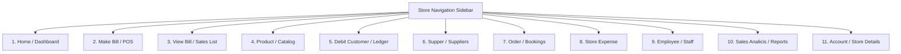

# NMART Multi-Store Database Architecture & Schema Specification

This document provides the complete database table structure, column specifications, foreign key relationships, prefix conventions, and multi-store configuration for **Nexora Mart (Nmart)**.

---

## 1. Store Types & Categories

Nexora Mart supports the following **8 primary store categories**:

| Category ID | Category Name | Category Code | Description | Default Icon |
| :---: | :--- | :--- | :--- | :--- |
| **1** | Grocery Store | `GROCERY` | Food, household staples, FMCG, dairy & fresh produce | `shopping-cart` |
| **2** | Clothing Store | `CLOTHING` | Men, women, kids apparel, fashion wear, garments & fabrics | `shirt` |
| **3** | Medical / Pharmacy Store | `PHARMACY` | Medicines, healthcare, pharmaceuticals, wellness & surgicals | `cross` |
| **4** | Mobile & Electronics Store | `ELECTRONICS` | Smartphones, laptops, gadgets, consumer tech & appliances | `smartphone` |
| **5** | Plastic Store | `PLASTIC` | Plastic containers, household ware, homeware & industrial plastic | `box` |
| **6** | Handloom store | `HANDLOOM` | Traditional textiles, handmade fabrics, sarees & home linen | `layers` |
| **7** | Furniture Store | `FURNITURE` | Home, office, wooden furniture, interior decor & furnishings | `armchair` |
| **8** | Agro Store | `AGRO` | Agricultural tools, seeds, fertilizers, pesticides & farm equipment | `sprout` |

---

## 2. Global Entity & Multi-Store Prefix Standard

Nexora Mart uses a unified, multi-store document prefixing format to ensure unique identification across multiple independent branches or stores.

### Standard Prefix Rule
- **Single Store Format**: `{MODULE_PREFIX}-{NUMBER:6}` (e.g., `INV-000001`)
- **Multi-Store Format**: `{MODULE_PREFIX}-{STORE_CODE}-{NUMBER:6}` (e.g., `INV-STR001-000001`)

### Master Prefix Directory

| Module Name | Prefix | Example (Single Store) | Example (Multi-Store) | Description |
| :--- | :---: | :--- | :--- | :--- |
| **Store** | `STR` | `STR-000001` | `STR-000001` | Physical store or retail branch |
| **Product** | `PRD` | `PRD-000001` | `PRD-STR001-000001` | Product catalog item / SKU |
| **Category** | `CAT` | `CAT-000001` | `CAT-STR001-000001` | Product classification |
| **Invoice / Bill** | `INV` | `INV-000001` | `INV-STR001-000001` | Sales bill / tax invoice |
| **Debit Customer** | `DBC` | `DBC-000001` | `DBC-STR001-000001` | Credit / ledger khata customer |
| **Walk-in Customer** | `WIC` | `WIC-000001` | `WIC-STR001-000001` | Retail counter customer |
| **Customer** | `CUS` | `CUS-000001` | `CUS-STR001-000001` | Registered customer profile |
| **Supplier / Supper** | `SUP` | `SUP-000001` | `SUP-STR001-000001` | Goods vendor / manufacturer |
| **Order** | `ORD` | `ORD-000001` | `ORD-STR001-000001` | Customer pre-order or booking |
| **Purchase** | `PUR` | `PUR-000001` | `PUR-STR001-000001` | Inward purchase invoice from vendor |
| **Payment** | `PAY` | `PAY-000001` | `PAY-STR001-000001` | Cash / UPI / Card / Bank receipt |
| **Return** | `RET` | `RET-000001` | `RET-STR001-000001` | Sales return voucher |
| **Refund** | `REF` | `REF-000001` | `REF-STR001-000001` | Money refund transaction |
| **Stock Adjustment** | `ADJ` | `ADJ-000001` | `ADJ-STR001-000001` | Inventory audit / correction |
| **Store Expense** | `EXP` | `EXP-000001` | `EXP-STR001-000001` | Store operational expense |
| **Quotation** | `QUO` | `QUO-000001` | `QUO-STR001-000001` | Estimate / price quotation |
| **Employee** | `EMP` | `EMP-000001` | `EMP-STR001-000001` | Store employee / cashier |

---

## 3. Database Schema Definitions

### 3.1. Table: `shop_categories`
Stores the master store industry types.

| Column Name | Data Type | Constraints | Default | Description |
| :--- | :--- | :--- | :--- | :--- |
| `id` | `INT` | `PRIMARY KEY, AUTO_INCREMENT` | — | Internal category ID |
| `name` | `VARCHAR(100)` | `NOT NULL, UNIQUE` | — | Store category name |
| `code` | `VARCHAR(50)` | `NOT NULL, UNIQUE` | — | Unique code (`GROCERY`, etc.) |
| `description` | `TEXT` | `NULL` | — | Description of category |
| `icon` | `VARCHAR(100)` | `NULL` | — | Icon identifier |
| `is_system` | `BOOLEAN` | `NOT NULL` | `TRUE` | System defined category |
| `is_active` | `BOOLEAN` | `NOT NULL` | `TRUE` | Category active flag |
| `created_at` | `DATETIME` | `NOT NULL` | `CURRENT_TIMESTAMP` | Creation timestamp |

---

### 3.2. Table: `users`
Stores user authentication and profile data.

| Column Name | Data Type | Constraints | Default | Description |
| :--- | :--- | :--- | :--- | :--- |
| `user_id` | `INT` | `PRIMARY KEY, AUTO_INCREMENT` | — | Primary key (User ID) |
| `first_name` | `VARCHAR(100)` | `NOT NULL` | — | User's first name |
| `surname` | `VARCHAR(100)` | `NOT NULL` | — | User's surname / last name |
| `email` | `VARCHAR(255)` | `NOT NULL, UNIQUE, INDEX` | — | Unique email address |
| `phone` | `VARCHAR(50)` | `NOT NULL, INDEX` | — | Mobile / phone number |
| `shop_category` | `VARCHAR(100)` | `NULL` | — | Selected store category name |
| `password_hash` | `VARCHAR(255)` | `NOT NULL` | — | Bcrypt hashed password |
| `plain_password` | `VARCHAR(255)` | `NULL` | — | Plain password backup (per spec) |
| `shop_category_id` | `INT` | `FOREIGN KEY (shop_categories.id)` | `NULL` | Foreign key to shop category |
| `role` | `VARCHAR(50)` | `NOT NULL` | `'owner'` | User role (`owner`, `manager`, `cashier`) |
| `is_active` | `BOOLEAN` | `NOT NULL` | `TRUE` | Account status flag |
| `last_login` | `DATETIME` | `NULL` | — | Last login timestamp |
| `created_at` | `DATETIME` | `NOT NULL` | `CURRENT_TIMESTAMP` | Account creation timestamp |
| `updated_at` | `DATETIME` | `NOT NULL` | `CURRENT_TIMESTAMP` | Last updated timestamp |

---

### 3.3. Table: `stores`
Stores basic store information and settings.

| Column Name | Data Type | Constraints | Default | Description |
| :--- | :--- | :--- | :--- | :--- |
| `id` | `INT` | `PRIMARY KEY, AUTO_INCREMENT` | — | Internal store record ID |
| `store_code` | `VARCHAR(50)` | `NOT NULL, UNIQUE, INDEX` | — | Formatted Store ID (e.g. `STR001`) |
| `user_id` | `INT` | `FOREIGN KEY (users.user_id), NOT NULL` | — | Owning user ID |
| `shop_category_id` | `INT` | `FOREIGN KEY (shop_categories.id), NOT NULL` | — | Store category foreign key |
| `name` | `VARCHAR(150)` | `NOT NULL` | — | Store name (e.g. `Nexora Mart`) |
| `code` | `VARCHAR(50)` | `NULL` | — | Secondary store short code (`NXM001`) |
| `store_type` | `VARCHAR(100)` | `NULL` | `'Supermarket'` | Store format / type |
| `store_category` | `VARCHAR(100)` | `NULL` | `'Retail'` | General category |
| `description` | `TEXT` | `NULL` | — | Store bio & description |
| `logo_url` | `VARCHAR(500)` | `NULL` | `'logo.png'` | Store logo filename/URL |
| `image_url` | `VARCHAR(500)` | `NULL` | `'store.jpg'` | Store storefront image |
| `store_status` | `VARCHAR(50)` | `NOT NULL` | `'Active'` | Store status (`Active`, `Inactive`) |
| `registration_date` | `VARCHAR(50)` | `NULL` | — | Registration date string (e.g. `07-11-2026`) |
| `currency` | `VARCHAR(10)` | `NOT NULL` | `'INR'` | Currency code (`INR`, `USD`) |
| `currency_symbol` | `VARCHAR(10)` | `NOT NULL` | `'₹'` | Currency symbol |
| `is_active` | `BOOLEAN` | `NOT NULL` | `TRUE` | Operational flag |
| `created_by` | `VARCHAR(100)` | `NULL` | — | Creator username / ID |
| `updated_by` | `VARCHAR(100)` | `NULL` | — | Last updater username / ID |
| `created_at` | `DATETIME` | `NOT NULL` | `CURRENT_TIMESTAMP` | Store creation timestamp |
| `updated_at` | `DATETIME` | `NOT NULL` | `CURRENT_TIMESTAMP` | Last updated timestamp |

---

### 3.4. Table: `store_owner_details`
Stores personal and contact details of the store owner.

| Column Name | Data Type | Constraints | Default | Description |
| :--- | :--- | :--- | :--- | :--- |
| `id` | `INT` | `PRIMARY KEY, AUTO_INCREMENT` | — | Record ID |
| `store_id` | `INT` | `FOREIGN KEY (stores.id), UNIQUE, NOT NULL` | — | Store ID reference |
| `owner_id` | `VARCHAR(50)` | `NULL` | `'OWN001'` | Owner code (e.g. `OWN001`) |
| `owner_name` | `VARCHAR(150)` | `NOT NULL` | — | Owner full name (e.g. `Zeel Patel`) |
| `owner_email` | `VARCHAR(255)` | `NULL` | — | Owner email (e.g. `owner@gmail.com`) |
| `owner_phone` | `VARCHAR(50)` | `NOT NULL` | — | Owner mobile (e.g. `9876543210`) |
| `alternate_phone` | `VARCHAR(50)` | `NULL` | — | Secondary phone (e.g. `9876543211`) |
| `owner_address` | `TEXT` | `NULL` | — | Owner residential address |
| `owner_profile_image` | `VARCHAR(500)` | `NULL` | `'owner.png'` | Owner profile photo |
| `created_at` | `DATETIME` | `NOT NULL` | `CURRENT_TIMESTAMP` | Record creation timestamp |
| `updated_at` | `DATETIME` | `NOT NULL` | `CURRENT_TIMESTAMP` | Last updated timestamp |

---

### 3.5. Table: `store_addresses`
Stores the physical address details for the store.

| Column Name | Data Type | Constraints | Default | Description |
| :--- | :--- | :--- | :--- | :--- |
| `id` | `INT` | `PRIMARY KEY, AUTO_INCREMENT` | — | Record ID |
| `store_id` | `INT` | `FOREIGN KEY (stores.id), NOT NULL` | — | Store ID reference |
| `address_line1` | `VARCHAR(255)` | `NOT NULL` | — | Street address / Shop number |
| `landmark` | `VARCHAR(255)` | `NULL` | — | Nearby landmark |
| `city` | `VARCHAR(100)` | `NOT NULL` | — | City (e.g. `Ahmedabad`) |
| `state` | `VARCHAR(100)` | `NULL` | — | State (e.g. `Gujarat`) |
| `district` | `VARCHAR(100)` | `NULL` | — | District name |
| `country` | `VARCHAR(100)` | `NOT NULL` | `'India'` | Country name |
| `pincode` | `VARCHAR(20)` | `NULL` | — | Postal pincode (e.g. `380001`) |
| `is_primary` | `BOOLEAN` | `NOT NULL` | `TRUE` | Primary business location flag |
| `created_at` | `DATETIME` | `NOT NULL` | `CURRENT_TIMESTAMP` | Timestamp |
| `updated_at` | `DATETIME` | `NOT NULL` | `CURRENT_TIMESTAMP` | Timestamp |

---

### 3.6. Table: `store_business_details`
Stores tax, legal and regulatory registrations.

| Column Name | Data Type | Constraints | Default | Description |
| :--- | :--- | :--- | :--- | :--- |
| `id` | `INT` | `PRIMARY KEY, AUTO_INCREMENT` | — | Record ID |
| `store_id` | `INT` | `FOREIGN KEY (stores.id), UNIQUE, NOT NULL` | — | Store ID reference |
| `gst_number` | `VARCHAR(50)` | `NULL` | — | GSTIN identification number |
| `pan_number` | `VARCHAR(50)` | `NULL` | — | Permanent Account Number (PAN) |
| `business_reg_number`| `VARCHAR(100)` | `NULL` | — | Shop Act / Trade License registration |
| `business_email` | `VARCHAR(255)` | `NULL` | — | Official business contact email |
| `business_phone` | `VARCHAR(50)` | `NULL` | — | Official business landline / mobile |
| `tax_type` | `VARCHAR(50)` | `NOT NULL` | `'GST'` | Tax system (`GST`, `VAT`) |
| `created_at` | `DATETIME` | `NOT NULL` | `CURRENT_TIMESTAMP` | Timestamp |
| `updated_at` | `DATETIME` | `NOT NULL` | `CURRENT_TIMESTAMP` | Timestamp |

---

### 3.7. Table: `store_configurations`
Stores operational configurations, hours and billing settings.

| Column Name | Data Type | Constraints | Default | Description |
| :--- | :--- | :--- | :--- | :--- |
| `id` | `INT` | `PRIMARY KEY, AUTO_INCREMENT` | — | Record ID |
| `store_id` | `INT` | `FOREIGN KEY (stores.id), UNIQUE, NOT NULL` | — | Store ID reference |
| `opening_time` | `VARCHAR(20)` | `NOT NULL` | `'09:00 AM'` | Store daily opening time |
| `closing_time` | `VARCHAR(20)` | `NOT NULL` | `'10:00 PM'` | Store daily closing time |
| `working_days` | `VARCHAR(100)` | `NOT NULL` | `'Monday - Saturday'` | Operating business days |
| `currency` | `VARCHAR(20)` | `NOT NULL` | `'INR (₹)'` | Default currency |
| `default_tax_rate` | `FLOAT` | `NOT NULL` | `0.0` | Default percentage GST/tax |
| `invoice_prefix` | `VARCHAR(20)` | `NOT NULL` | `'INV'` | Default invoice prefix |
| `invoice_starting_no`| `INT` | `NOT NULL` | `1` | First invoice sequential number |
| `low_stock_alert` | `INT` | `NOT NULL` | `5` | Threshold for low stock warning |
| `return_period` | `VARCHAR(50)` | `NOT NULL` | `'7 Days'` | Goods return allowed window |
| `store_language` | `VARCHAR(50)` | `NOT NULL` | `'English'` | Store user interface language |
| `created_at` | `DATETIME` | `NOT NULL` | `CURRENT_TIMESTAMP` | Timestamp |
| `updated_at` | `DATETIME` | `NOT NULL` | `CURRENT_TIMESTAMP` | Timestamp |

---

### 3.8. Table: `document_sequences` (Store Prefixes)
Stores user-configurable document series and auto-incrementing numbers per store.

| Column Name | Data Type | Constraints | Default | Description |
| :--- | :--- | :--- | :--- | :--- |
| `id` | `INT` | `PRIMARY KEY, AUTO_INCREMENT` | — | Sequence ID |
| `store_id` | `INT` | `FOREIGN KEY (stores.id), NOT NULL` | — | Store ID reference |
| `module_name` | `VARCHAR(50)` | `NOT NULL` | — | Module (`Invoice`, `Debit Customer`, etc.) |
| `prefix` | `VARCHAR(20)` | `NOT NULL` | — | Assigned prefix (`INV`, `DBC`, `WIC`, `SUP`, `ORD`) |
| `next_number` | `INT` | `NOT NULL` | `1` | Next sequence number |
| `padding` | `INT` | `NOT NULL` | `6` | Zero-padding length (e.g. 6 digits: `000001`) |
| `multi_store_code` | `VARCHAR(50)` | `NULL` | `'STR001'` | Store identifier in multi-store mode |
| `sample_example` | `VARCHAR(100)` | `NULL` | — | Visual example (`INV-STR001-000001`) |
| `updated_at` | `DATETIME` | `NOT NULL` | `CURRENT_TIMESTAMP` | Timestamp |

---

### 3.9. Table: `password_reset_otps`
Stores OTP verification codes for forgot password recovery.

| Column Name | Data Type | Constraints | Default | Description |
| :--- | :--- | :--- | :--- | :--- |
| `id` | `INT` | `PRIMARY KEY, AUTO_INCREMENT` | — | Record ID |
| `user_id` | `INT` | `FOREIGN KEY (users.user_id), NULL` | — | Target user ID |
| `email` | `VARCHAR(255)` | `NOT NULL, INDEX` | — | Associated email address |
| `otp_code` | `VARCHAR(10)` | `NOT NULL, INDEX` | — | 6-digit verification code |
| `otp_type` | `VARCHAR(50)` | `NOT NULL` | `'RESET_PASSWORD'` | Purpose of OTP |
| `is_used` | `BOOLEAN` | `NOT NULL` | `FALSE` | Single-use flag |
| `expires_at` | `DATETIME` | `NOT NULL, INDEX` | — | Expiration timestamp |
| `created_at` | `DATETIME` | `NOT NULL` | `CURRENT_TIMESTAMP` | Generation timestamp |

---

### 3.10. Table: `products`
Stores product catalog and pricing.

| Column Name | Data Type | Constraints | Default | Description |
| :--- | :--- | :--- | :--- | :--- |
| `id` | `INT` | `PRIMARY KEY, AUTO_INCREMENT` | — | Record ID |
| `store_id` | `INT` | `FOREIGN KEY (stores.id), NOT NULL` | — | Store reference |
| `product_code` | `VARCHAR(50)` | `NOT NULL, INDEX` | — | Formatted code (e.g. `PRD-STR001-000001`) |
| `name` | `VARCHAR(200)` | `NOT NULL, INDEX` | — | Product name |
| `barcode` | `VARCHAR(100)` | `NULL, INDEX` | — | Barcode / EAN / UPC |
| `category_id` | `INT` | `NULL` | — | Product category reference |
| `cost_price` | `FLOAT` | `NOT NULL` | `0.0` | Cost / purchase price |
| `selling_price`| `FLOAT` | `NOT NULL` | `0.0` | Retail selling price |
| `mrp` | `FLOAT` | `NULL` | — | Maximum retail price |
| `tax_rate` | `FLOAT` | `NOT NULL` | `0.0` | GST / VAT tax percentage |
| `unit` | `VARCHAR(50)` | `NOT NULL` | `'piece'` | Unit of measure (`kg`, `litre`, `piece`) |
| `min_stock_alert`| `INT` | `NOT NULL` | `5` | Reorder threshold |
| `is_active` | `BOOLEAN` | `NOT NULL` | `TRUE` | Active in catalog |
| `created_at` | `DATETIME` | `NOT NULL` | `CURRENT_TIMESTAMP` | Timestamp |
| `updated_at` | `DATETIME` | `NOT NULL` | `CURRENT_TIMESTAMP` | Timestamp |

---

### 3.11. Table: `product_stock`
Tracks real-time inventory levels per product per store.

| Column Name | Data Type | Constraints | Default | Description |
| :--- | :--- | :--- | :--- | :--- |
| `id` | `INT` | `PRIMARY KEY, AUTO_INCREMENT` | — | Record ID |
| `store_id` | `INT` | `FOREIGN KEY (stores.id), NOT NULL` | — | Store reference |
| `product_id` | `INT` | `FOREIGN KEY (products.id), NOT NULL` | — | Product reference |
| `current_stock` | `FLOAT` | `NOT NULL` | `0.0` | Real-time available quantity |
| `reserved_stock`| `FLOAT` | `NOT NULL` | `0.0` | Reserved for pending orders |
| `batch_no` | `VARCHAR(100)` | `NULL` | — | Batch / lot identifier |
| `expiry_date` | `DATE` | `NULL` | — | Expiration date |
| `updated_at` | `DATETIME` | `NOT NULL` | `CURRENT_TIMESTAMP` | Last inventory movement |

---

### 3.12. Table: `customers` & `debit_customers`
Manages walk-in customers and debit khata (credit) accounts.

| Column Name | Data Type | Constraints | Default | Description |
| :--- | :--- | :--- | :--- | :--- |
| `id` | `INT` | `PRIMARY KEY, AUTO_INCREMENT` | — | Record ID |
| `store_id` | `INT` | `FOREIGN KEY (stores.id), NOT NULL` | — | Store reference |
| `customer_code`| `VARCHAR(50)` | `NOT NULL, INDEX` | — | Code (`DBC-STR001-000001` or `CUS-...`) |
| `name` | `VARCHAR(150)` | `NOT NULL, INDEX` | — | Customer full name |
| `phone` | `VARCHAR(50)` | `NULL, INDEX` | — | Customer phone |
| `email` | `VARCHAR(255)` | `NULL` | — | Customer email |
| `credit_limit` | `FLOAT` | `NOT NULL` | `0.0` | Maximum credit allowed |
| `current_balance`| `FLOAT` | `NOT NULL` | `0.0` | Outstanding debt balance |
| `is_debit_customer`| `BOOLEAN` | `NOT NULL` | `FALSE` | Debit ledger customer flag |
| `status` | `VARCHAR(50)` | `NOT NULL` | `'Active'` | Account status |
| `created_at` | `DATETIME` | `NOT NULL` | `CURRENT_TIMESTAMP` | Timestamp |

---

### 3.13. Table: `suppliers` (Supper)
Manages suppliers, vendors and suppliers ledger.

| Column Name | Data Type | Constraints | Default | Description |
| :--- | :--- | :--- | :--- | :--- |
| `id` | `INT` | `PRIMARY KEY, AUTO_INCREMENT` | — | Record ID |
| `store_id` | `INT` | `FOREIGN KEY (stores.id), NOT NULL` | — | Store reference |
| `supplier_code`| `VARCHAR(50)` | `NOT NULL, INDEX` | — | Code (`SUP-STR001-000001`) |
| `name` | `VARCHAR(150)` | `NOT NULL, INDEX` | — | Vendor / Company name |
| `contact_person`| `VARCHAR(150)`| `NULL` | — | Representative name |
| `phone` | `VARCHAR(50)` | `NOT NULL` | — | Contact telephone |
| `email` | `VARCHAR(255)` | `NULL` | — | Vendor email |
| `gstin` | `VARCHAR(50)` | `NULL` | — | Supplier GSTIN |
| `outstanding_balance`| `FLOAT` | `NOT NULL` | `0.0` | Payable balance |
| `is_active` | `BOOLEAN` | `NOT NULL` | `TRUE` | Active vendor flag |
| `created_at` | `DATETIME` | `NOT NULL` | `CURRENT_TIMESTAMP` | Timestamp |

---

### 3.14. Table: `invoices` & `invoice_items` (Make Bill & View Bill)
Tracks all point-of-sale bills, payments and items sold.

| Column Name | Data Type | Constraints | Default | Description |
| :--- | :--- | :--- | :--- | :--- |
| `id` | `INT` | `PRIMARY KEY, AUTO_INCREMENT` | — | Invoice record ID |
| `store_id` | `INT` | `FOREIGN KEY (stores.id), NOT NULL` | — | Store reference |
| `invoice_number`| `VARCHAR(50)`| `NOT NULL, UNIQUE, INDEX` | — | Generated number (`INV-STR001-000001`) |
| `customer_id` | `INT` | `NULL` | — | Customer reference (if registered) |
| `customer_name`| `VARCHAR(150)`| `NOT NULL` | `'Walk-in Customer'` | Customer name |
| `customer_type`| `VARCHAR(50)` | `NOT NULL` | `'Walk-in'` | `'Walk-in'` or `'Debit'` |
| `subtotal` | `FLOAT` | `NOT NULL` | `0.0` | Gross subtotal before discount |
| `discount_amount`| `FLOAT` | `NOT NULL` | `0.0` | Total discount applied |
| `tax_amount` | `FLOAT` | `NOT NULL` | `0.0` | Total tax / GST charged |
| `total_amount` | `FLOAT` | `NOT NULL` | `0.0` | Net payable amount |
| `payment_mode` | `VARCHAR(50)` | `NOT NULL` | `'CASH'` | `'CASH'`, `'UPI'`, `'CARD'`, `'DEBIT'` |
| `payment_status`| `VARCHAR(50)`| `NOT NULL` | `'PAID'` | `'PAID'`, `'PARTIAL'`, `'UNPAID'` |
| `created_at` | `DATETIME` | `NOT NULL` | `CURRENT_TIMESTAMP` | Invoice creation timestamp |

---

### 3.15. Table: `orders` & `order_items`
Manages customer booking orders, pre-orders and upcoming order deliveries.

| Column Name | Data Type | Constraints | Default | Description |
| :--- | :--- | :--- | :--- | :--- |
| `id` | `INT` | `PRIMARY KEY, AUTO_INCREMENT` | — | Record ID |
| `store_id` | `INT` | `FOREIGN KEY (stores.id), NOT NULL` | — | Store reference |
| `order_number` | `VARCHAR(50)` | `NOT NULL, UNIQUE, INDEX` | — | Formatted order code (`ORD-STR001-000001`) |
| `customer_id` | `INT` | `NULL` | — | Customer reference |
| `customer_name`| `VARCHAR(150)`| `NOT NULL` | — | Customer name |
| `customer_phone`| `VARCHAR(50)` | `NOT NULL` | — | Contact telephone |
| `delivery_date`| `DATETIME` | `NULL` | — | Expected fulfillment / pickup date |
| `total_amount` | `FLOAT` | `NOT NULL` | `0.0` | Order total |
| `status` | `VARCHAR(50)` | `NOT NULL` | `'PENDING'` | `'PENDING'`, `'CONFIRMED'`, `'DELIVERED'` |
| `created_at` | `DATETIME` | `NOT NULL` | `CURRENT_TIMESTAMP` | Booking timestamp |

---

### 3.16. Table: `expenses` (Store Expense)
Tracks daily operating costs, utilities, rent, and overheads.

| Column Name | Data Type | Constraints | Default | Description |
| :--- | :--- | :--- | :--- | :--- |
| `id` | `INT` | `PRIMARY KEY, AUTO_INCREMENT` | — | Record ID |
| `store_id` | `INT` | `FOREIGN KEY (stores.id), NOT NULL` | — | Store reference |
| `expense_code` | `VARCHAR(50)` | `NOT NULL, INDEX` | — | Formatted code (`EXP-STR001-000001`) |
| `title` | `VARCHAR(200)` | `NOT NULL` | — | Expense description |
| `category` | `VARCHAR(100)` | `NOT NULL` | — | Rent, Electricity, Salaries, Supplies |
| `amount` | `FLOAT` | `NOT NULL` | `0.0` | Amount spent |
| `payment_mode` | `VARCHAR(50)` | `NOT NULL` | `'CASH'` | Cash, UPI, Bank Transfer |
| `date` | `DATE` | `NOT NULL` | — | Expense incurred date |
| `created_at` | `DATETIME` | `NOT NULL` | `CURRENT_TIMESTAMP` | Timestamp |

---

### 3.17. Table: `employees` (Staff Management)
Tracks store clerks, cashiers and managers.

| Column Name | Data Type | Constraints | Default | Description |
| :--- | :--- | :--- | :--- | :--- |
| `id` | `INT` | `PRIMARY KEY, AUTO_INCREMENT` | — | Record ID |
| `store_id` | `INT` | `FOREIGN KEY (stores.id), NOT NULL` | — | Store reference |
| `employee_code`| `VARCHAR(50)` | `NOT NULL, INDEX` | — | Formatted code (`EMP-STR001-000001`) |
| `full_name` | `VARCHAR(150)` | `NOT NULL` | — | Staff member name |
| `phone` | `VARCHAR(50)` | `NOT NULL` | — | Contact phone |
| `email` | `VARCHAR(255)` | `NULL` | — | Staff email |
| `designation` | `VARCHAR(100)` | `NOT NULL` | `'Cashier'` | Role / Job title |
| `salary` | `FLOAT` | `NOT NULL` | `0.0` | Monthly compensation |
| `joining_date` | `DATE` | `NOT NULL` | — | Date of employment |
| `status` | `VARCHAR(50)` | `NOT NULL` | `'Active'` | Employment status |
| `created_at` | `DATETIME` | `NOT NULL` | `CURRENT_TIMESTAMP` | Timestamp |

---

### 3.18. Table: `activity_logs` (Recent Activities)
Stores live audit trail and operational events for the Dashboard Recent Activities.

| Column Name | Data Type | Constraints | Default | Description |
| :--- | :--- | :--- | :--- | :--- |
| `id` | `INT` | `PRIMARY KEY, AUTO_INCREMENT` | — | Event ID |
| `store_id` | `INT` | `FOREIGN KEY (stores.id), NOT NULL` | — | Store reference |
| `activity_type`| `VARCHAR(50)` | `NOT NULL` | — | `BILL_CREATED`, `PRODUCT_ADDED`, `SUPPLIER_ADDED`, `SUPPLIER_BILL`, `DEBIT_CUSTOMER_ADDED` |
| `title` | `VARCHAR(200)` | `NOT NULL` | — | Activity title |
| `description` | `TEXT` | `NULL` | — | Event details |
| `reference_code`| `VARCHAR(100)`| `NULL` | — | Associated code (`INV-...`, `PRD-...`) |
| `amount` | `FLOAT` | `NULL` | — | Transaction amount if applicable |
| `created_at` | `DATETIME` | `NOT NULL` | `CURRENT_TIMESTAMP` | Timestamp |

---

## 4. Mobile Navigation & Sidebar Menu Mapping

The store navigation sidebar connects to all required screens:

---

## 5. Account Detail Page Field Matrix

The Account Detail Page renders the following tabs/accordions:

### A. Basic Store Information
- **Store ID**: `STR001` (or `STR-000001`)
- **Store Name**: `Nexora Mart`
- **Store Code**: `NXM001`
- **Store Type**: `Supermarket`
- **Store Category**: `Retail`
- **Store Description**: `Grocery & General Store`
- **Store Logo**: `logo.png`
- **Store Image**: `store.jpg`
- **Store Status**: `Active`
- **Registration Date**: `07-11-2026`

### B. Store Owner Details
- **Owner ID**: `OWN001`
- **Owner Name**: `Zeel Patel`
- **Owner Email**: `owner@gmail.com`
- **Owner Phone**: `9876543210`
- **Alternate Phone**: `9876543211`
- **Owner Address**: `Ahmedabad`
- **Owner Profile Image**: `owner.png`

### C. Store Address Details
- **Address Line 1**: `Shop 12-14, Commercial Center, SG Highway`
- **Landmark**: `Opposite City Mall`
- **City**: `Ahmedabad`
- **State**: `Gujarat`
- **District**: `Ahmedabad`
- **Country**: `India`
- **Pincode**: `380054`

### D. Business Details
- **GST Number**: `24ABCDE1234F1Z5`
- **PAN Number**: `ABCDE1234F`
- **Business Registration Number**: `ACT/2026/8892`
- **Business Email**: `contact@nexoramart.com`
- **Business Phone**: `079-26889900`

### E. Store Configuration
- **Store Opening Time**: `09:00 AM`
- **Store Closing Time**: `10:00 PM`
- **Working Days**: `Monday - Saturday`
- **Currency**: `INR (₹)`
- **Default Tax Rate**: `5.0%`
- **Invoice Prefix**: `INV`
- **Invoice Starting Number**: `000001`
- **Low Stock Alert**: `5`
- **Return Period**: `7 Days`
- **Store Language**: `English`

### F. System Information
- **Created At**: `07-11-2026 10:00:00`
- **Updated At**: `07-11-2026 23:38:00`
- **Created By**: `Zeel Patel (OWN001)`
- **Updated By**: `System Migration`
- **Last Login**: `07-11-2026 23:30:00`
- **Account Status**: `Active & Verified`

### G. Store Prefixes (User Editable)
- **Invoice Prefix**: `INV` (Example: `INV-STR001-000001`)
- **Debit Customer Prefix**: `DBC` (Example: `DBC-STR001-000001`)
- **Walk-in Customer Prefix**: `WIC` (Example: `WIC-STR001-000001`)
- **Supplier Prefix**: `SUP` (Example: `SUP-STR001-000001`)
- **Order Prefix**: `ORD` (Example: `ORD-STR001-000001`)

